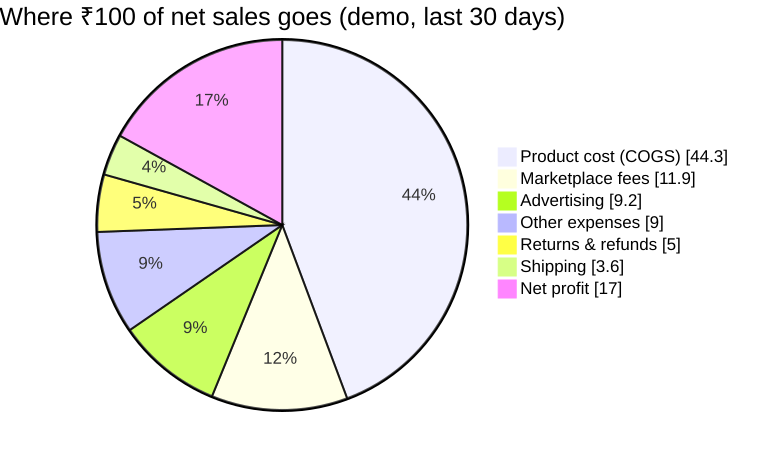
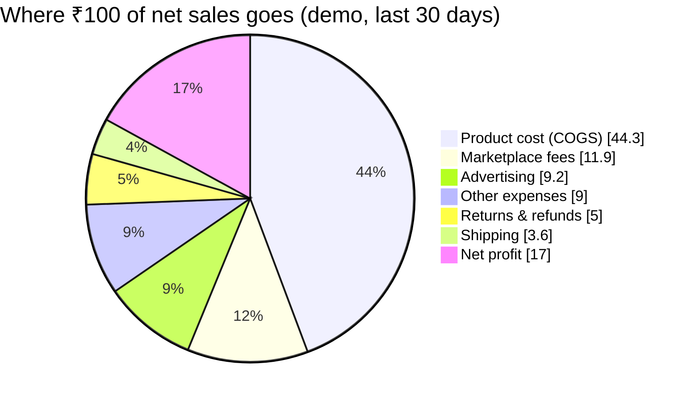
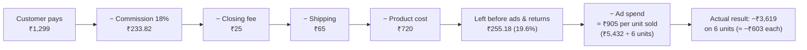
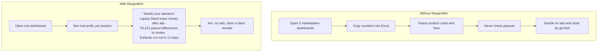

# 0. Why MarginMint exists

> **Who this is for:** everyone joining the project (engineers, designers, anyone new) who wants to understand *why* we are building this before *how*. Read this first.
>
> For the business detail (target customer, competitors, pricing, how to validate with sellers) see [Seller value & product plan](13-seller-value-and-product-plan.md).

---

## 0.1 The answer in one paragraph

Indian e-commerce sellers can easily see how much they **sold**, but almost never how much they **earned**. Between the sale price and the money that stays in the bank sit product cost, marketplace commission, closing fees, shipping, advertising, returns, overheads and payout deductions, spread across Amazon, Flipkart, Shopify and their own website, each with a different dashboard and settlement cycle. MarginMint pulls all of it into one place and answers the questions that decide whether a business survives: **Which products make money? Which lose it? Did the marketplace pay me correctly? What should I do next?**

> **Our principle: revenue is not profit. Make every cost visible.**

---

## 0.2 The problem, shown with numbers

The numbers below come from MarginMint's own calculations on the **demo workspace** (simulated, but built with realistic Indian marketplace fees). They show the shape of a real seller's problem.

### Sales look healthy; profit is a fraction of it

Over 30 days the demo seller had **₹1,23,455 in net sales** from 64 orders. Here is where that money went:

Diagram source (Mermaid): edit here, then run <code>npm run docs:diagrams</code>

| Line | Amount | Share of net sales |
|------|-------:|-------------------:|
| Net sales | ₹1,23,455 | 100% |
| Product cost (COGS) | −₹54,690 | 44.3% |
| Marketplace fees | −₹14,710 | 11.9% |
| Shipping | −₹4,420 | 3.6% |
| Advertising | −₹11,331 | 9.2% |
| Refund & return losses | −₹6,112 | 5.0% |
| Other expenses (packaging, software, storage) | −₹11,149 | 9.0% |
| **Net profit** | **₹21,044** | **17.0%** |

**83% of every rupee sold is cost.** A seller who only looks at the marketplace sales dashboard sees ₹1,23,455 and has no idea that only ₹21,044 is profit, or which products produced it.

### Two products, the same sales, opposite results

| Product | Net sales (30 days) | Profit before ads | Ad spend | **Net profit** |
|---------|--------------------:|------------------:|---------:|---------------:|
| Insulated Travel Mug | ₹7,191 | ₹3,870 | ₹0 | **+₹3,870** (53.8% margin) |
| Laptop Stand | ₹7,794 | ₹1,813 | ₹5,432 | **−₹3,619** (−46.4% margin) |

On a sales dashboard these two products look the same, and the Laptop Stand even looks slightly *better*. In reality the seller **loses ₹3,619 a month** on it, because advertising wipes out its thin margin. Without per-product profit, the seller would probably spend *more* on Laptop Stand ads.

### One sale, step by step

Take a single Laptop Stand sold on Amazon for ₹1,299:

Diagram source (Mermaid): edit here, then run <code>npm run docs:diagrams</code>

Every step is small and easy to miss. Together they decide whether the product is worth selling. In the demo, advertising cost ₹5,432 against ₹1,813 the product earned before ads, about 3×. (₹255.18 is the rate-card estimate per unit; the actual figures also include discounts.)

### Money goes missing in payouts

Marketplaces pay sellers every few days, after deducting their own fees. In the demo, **16 payouts did not match** what the seller should have received: **₹3,221 of differences**, with the seller **underpaid ₹1,516 overall**. Checking this by hand means matching every order against every payout line in spreadsheets, so most sellers never do it, and the money is never claimed.

### Returns hide the biggest leaks

The demo's Cotton T-Shirt had **7 of 16 units returned (43.8%)**. Each return costs the refund plus shipping both ways, and sometimes the product itself. It turned a profitable product into a loss of ₹7. In India, cash-on-delivery orders that come back unopened (RTO) make this worse.

---

## 0.3 The six questions sellers cannot answer today

```mermaid
flowchart LR
    subgraph today["Today: scattered data"]
        a["Amazon Seller Central"]
        f["Flipkart Seller Hub"]
        sh["Shopify / own website"]
        x["Excel sheets"]
        acc["Month-end accountant"]
    end
    subgraph questions["What the seller needs to know"]
        q1["How much profit did I really make?"]
        q2["Which products lose money?"]
        q3["Did the marketplace pay me correctly?"]
        q4["What do returns cost me?"]
        q5["Is my advertising profitable?"]
        q6["What will run out of stock?"]
    end
    today -. "hours of manual work,<br/>usually never done" .-> questions
```

Diagram source (Mermaid): edit here, then run <code>npm run docs:diagrams</code>

| # | Question | Why it is hard today |
|---|----------|----------------------|
| 1 | How much profit did I really make this month? | Sales dashboards show revenue; costs live in different places |
| 2 | Which products make money, and which lose it? | Fees, ads and returns are not broken down per product |
| 3 | Did the marketplace pay me what it owed? | Payout statements must be matched line by line against orders |
| 4 | What are returns and RTO costing me? | Refunds, two-way shipping and damaged stock are recorded separately |
| 5 | Is my advertising profitable after all costs? | Ad platforms report "attributed sales", not profit |
| 6 | Which products will run out, and which are dead stock? | Stock and sales speed live in different systems |

**What sellers use instead:** Excel, a month-end accountant, or guessing. Excel is the real competitor: flexible and free, but slow, error-prone and usually out of date.

---

## 0.4 Why existing options fall short

| Option | Good at | Why it doesn't solve this |
|--------|---------|---------------------------|
| Marketplace dashboards | Sales and orders on that one marketplace | Show revenue, not profit; one marketplace at a time; no payout checking |
| Excel + accountant | Flexible, familiar | Manual, monthly at best, easy to get wrong, no alerts |
| Operations tools (order/inventory management) | Shipping orders and syncing stock | Built for operations, not for profit per product or settlement checks |
| Amazon-first analytics tools | Amazon profit and ads | Weaker on Flipkart and on Indian specifics (GST, COD, RTO, TCS/TDS) |

MarginMint focuses on the gap: **honest, per-product profit and payout checking across Indian marketplaces, simple enough for a growing seller who still does the numbers personally.** (Detail and validation plan: [Seller value & product plan](13-seller-value-and-product-plan.md).)

---

## 0.5 What MarginMint does about each problem

Status comes from the [product roadmap](roadmap/README.md) (✅ built and verified · 🧪 built, not yet tested live · 🔜 planned).

| Seller problem | What MarginMint does | Where it stands |
|----------------|----------------------|-----------------|
| "I don't know my real profit" | One calculation path from sales to net profit, with every cost visible (Overview, Profit Analytics, P&L report) | ✅ on demo data (C-01, C-07) · 🔜 on real data (D-03) |
| "Which products lose money?" | Per-product profit after fees, ads and returns; automatic "loses money after advertising" alerts | ✅ demo (C-04, C-07) · 🔜 real costs (D-01, D-02) |
| "Was I paid correctly?" | Expected vs received for every payout; differences flagged for review | ✅ view (C-08) · 🔜 import + matching engine (D-04, D-05, D-06) |
| "What do returns cost?" | Unit-level return rate, refund value, loss after recovered stock, reasons, worst products | ✅ demo (C-09) · 🔭 returns sync (D-08) |
| "Is advertising worth it?" | Spend, attributed sales, ROAS/ACOS, and profit *after* ads per product | ✅ demo (C-10) · 🔭 ads import (D-09) |
| "What will run out?" | Days of cover from real sales speed; no fake forecasts without history | ✅ (C-06, C-04) |
| "My data is in four places" | Amazon and Flipkart connected through their official APIs; orders synced automatically | 🧪 built (I-03 to I-06) · 🔜 live test, scheduled sync (I-08, I-10) |
| "I need to share numbers" | Every report viewable on screen with charts, or downloaded as CSV, or printed | ✅ (C-11, C-12) |
| "Is my data safe?" | Encrypted marketplace tokens, no buyer personal data, no passwords requested | ✅ (I-02) · 🔜 login and private workspaces (A-01, A-02) |

### Before and after, for one seller's Monday morning

Diagram source (Mermaid): edit here, then run <code>npm run docs:diagrams</code>

---

## 0.6 Why this matters especially in India

- **Several marketplaces at once.** Growing sellers sell on Amazon *and* Flipkart, often Shopify or their own site too, each with different fees and payout cycles (7, 10, 2–3 days).
- **Cash on delivery and RTO.** Unopened COD orders coming back cost shipping both ways and are a large hidden loss.
- **GST and tax deductions.** GST collected is not income; TCS/TDS reduce payouts. Getting this wrong overstates profit and destroys trust.
- **Thin margins.** Marketplace commissions often take a double-digit share of the sale depending on category, and ad costs keep rising, so a few percent decides profit or loss and precision matters.
- **Owner-run businesses.** The owner usually does the numbers personally, late at night, in Excel. They need answers and actions, not more charts.

---

## 0.7 The principles that follow from "why"

These are not style choices; each one exists because of the problem above. They are enforced in the [coding rules](../.cursor/rules/) and tests.

| Principle | Why |
|-----------|-----|
| **Revenue is not profit** | The whole product exists to show the gap |
| **Unknown is not zero** | A missing product cost shown as ₹0 would make a loss look like profit |
| **Settlements are not sales** | Counting payouts as sales would double-count revenue |
| **Exact money math** (paise + decimals, never floats) | Sellers will stop trusting the product after a single wrong rupee |
| **Every number traceable** | One ledger feeds every page and report, so totals always agree |
| **Insights only from real data** | A fake alert is worse than no alert |
| **Actions, not just charts** | Every insight says what to do next and links to the evidence |
| **Honest labels** | Demo, synced and estimated data are always labelled as such |
| **Never ask for marketplace passwords** | Only official OAuth; tokens encrypted |

---

## 0.8 Honest status, and what has to happen next

**Today MarginMint is a strong foundation, not yet a product a seller can rely on.** The analytics run on demo data; real Amazon/Flipkart sync is built but not yet run against a live account; there is no login yet. See the [roadmap](roadmap/README.md) for every step and its status.

The path to real value, in order:

1. **Login and private workspaces** (A-01, A-02): sellers will not connect real accounts otherwise.
2. **First live marketplace sync** (I-08, I-09): prove real orders come in correctly.
3. **Product costs and marketplace fees** (D-01, D-02): without them, profit cannot be calculated.
4. **Real profit on the dashboard** (D-03): the core promise, on real data.
5. **Payout reconciliation** (D-04 to D-06): finds money owed, the feature most likely to make the product pay for itself.

And before building much more: **talk to real sellers** (Q-05 and [Seller value §13.8](13-seller-value-and-product-plan.md#138-prove-it-before-building-more)). The biggest risk is not the code; it is whether sellers will pay.

---

## 0.9 Where to go next

| If you want to… | Read |
|-----------------|------|
| See what exists today | [Project overview](01-project-overview.md) |
| Run it | [Getting started](02-getting-started.md) |
| Understand the money logic | [Financial logic](04-financial-logic.md) |
| See the whole product on one page | [Full product architecture](architecture/10-full-product-architecture.md) |
| Track progress | [Product roadmap](roadmap/README.md) |
| Understand the business case | [Seller value & product plan](13-seller-value-and-product-plan.md) |
