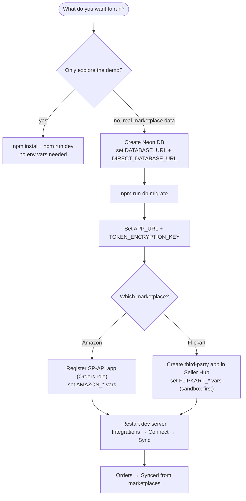
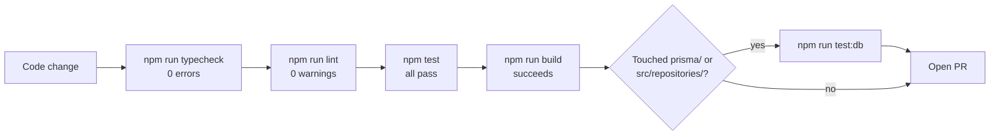

# 2. Getting started

## 2.1 Prerequisites

- **Node.js 22 or newer.** Netlify builds with Node 22 (`netlify.toml`); local development has been done on Node 26. Node 22+ is required because the code uses `process.loadEnvFile`, `--env-file` and the global `WebSocket`/`fetch`.
- **npm 11.** Newer npm versions hold back package install scripts until approved. Prisma works without them, so you do not need to approve anything.
- **Optional:** a Neon (PostgreSQL) database, only if you want marketplace sync.

## 2.2 Run the demo (no setup needed)

```bash
git clone https://github.com/actoelevate-git-org/marginmint-prototype.git
cd marginmint-prototype
npm install          # also runs `prisma generate` (postinstall)
npm run dev          # http://localhost:3000
```

The app opens on `/overview`. Every analytics page works on demo data. The Integrations page will say Amazon and Flipkart are **Not configured** and list the missing variables. That is expected.

## 2.3 Enable the database and marketplace sync



<details>
<summary>Diagram source (Mermaid): edit here, then run <code>npm run docs:diagrams</code></summary>



</details>

### Step 1: create `.env.local`

Copy `.env.example` to `.env.local`. **`.env.local` is gitignored; never commit it.**

| Variable | Required for | What it is |
|----------|--------------|------------|
| `DATABASE_URL` | Sync, synced orders | Neon **pooled** connection string (host contains `-pooler`). Used by the app at runtime. |
| `DIRECT_DATABASE_URL` | Migrations | Neon **direct** connection string (same host without `-pooler`). Used only by `npm run db:migrate`. |
| `APP_URL` | OAuth | The app's public base URL, e.g. `http://localhost:3000`. OAuth redirect URIs are built from it. |
| `TOKEN_ENCRYPTION_KEY` | OAuth | 32 random bytes, base64. Generate with `openssl rand -base64 32`. Encrypts marketplace tokens at rest. |
| `AMAZON_SPAPI_APP_ID` | Amazon | App ID from Seller Central → Develop Apps (`amzn1.sp.solution…`) |
| `AMAZON_LWA_CLIENT_ID` | Amazon | Login with Amazon client ID |
| `AMAZON_LWA_CLIENT_SECRET` | Amazon | Login with Amazon client secret |
| `AMAZON_SPAPI_DRAFT_APP` | Amazon | `"true"` (default) while the app is in Draft state. This adds `version=beta` to the consent URL. |
| `FLIPKART_CLIENT_ID` | Flipkart | Flipkart Seller Hub application ID |
| `FLIPKART_CLIENT_SECRET` | Flipkart | Flipkart application secret |
| `FLIPKART_API_HOST` | Flipkart (optional) | Override the API host, e.g. the sandbox `https://sandbox-api.flipkart.net` |
| `INTERNAL_DOCS_PASSWORD` | `/internal` in production | Password for the internal handbook (HTTP Basic, any username). Unset → `/internal` returns 404 in production. Not needed locally. |

**Rules about these values:**

- All of them are **server-only**. None is ever sent to the browser.
- Use `sslmode=verify-full` in Neon URLs (not `require`). The `pg` driver will weaken `require` in its next major version.
- `TOKEN_ENCRYPTION_KEY` must be **the same** in every environment that shares a database. If it changes, stored tokens cannot be decrypted and sellers must reconnect.

### Step 2: create the tables

```bash
npm run db:migrate   # applies prisma/migrations/* to the database
```

`prisma.config.ts` loads `.env.local` automatically for CLI commands, because Prisma 7 does not read env files by itself.

### Step 3: register the marketplace apps

These credentials are issued by the marketplaces; nobody can generate them for you.

**Amazon (Selling Partner API)**
1. Register as an SP-API developer in Seller Central (India: `https://sellercentral.amazon.in`).
2. Create an app with the **Orders** role. Do not request restricted roles; we do not need buyer PII.
3. Set the OAuth redirect URI to `{APP_URL}/api/integrations/amazon/callback`.
4. Copy the App ID, LWA client ID and secret into `.env.local`.
5. Keep `AMAZON_SPAPI_DRAFT_APP=true` until the app is published in the Selling Partner Appstore.

**Flipkart (Marketplace Seller API)**
1. In Flipkart Seller Hub, create a **third-party** application (authorization-code flow).
2. Set the redirect URI to `{APP_URL}/api/integrations/flipkart/callback`.
3. Copy the client ID and secret into `.env.local`. Use the sandbox host while testing.

### Step 4: connect and sync

1. Restart `npm run dev` (Next.js reads `.env.local` at startup).
2. Open **Integrations** → **Connect Amazon** (or Flipkart) → approve on the marketplace site.
3. Back on Integrations, click **Sync orders now**.
4. Open **Orders** → **Synced from marketplaces**.

## 2.4 The internal handbook (`/internal`)

Run the app and open **http://localhost:3000/internal**. It shows every page in `docs/`, all architecture diagrams, every coding rule, AGENTS.md, the README, the product spec and an environment-variable table. All of it is generated from the files in the repo, so it always matches the code.

- Development: open, no password.
- Production: hidden (404) unless `INTERNAL_DOCS_PASSWORD` is set; then the browser asks for it.
- Never indexed by search engines (`noindex`) and never cached.

## 2.5 All commands

| Command | What it does |
|---------|--------------|
| `npm run dev` | Development server with hot reload |
| `npm run build` | `prisma generate` + production build (what Netlify runs) |
| `npm start` | Serve the production build |
| `npm run lint` | ESLint (Next.js core-web-vitals + TypeScript rules) |
| `npm run typecheck` | `prisma generate` + `tsc --noEmit` (strict) |
| `npm test` | All unit and service tests (no network, no database) |
| `npm run test:watch` | Tests in watch mode |
| `npm run test:db` | Opt-in tests against the real database in `.env.local` (creates and then deletes a throwaway workspace) |
| `npm run db:generate` | Regenerate the Prisma client into `src/generated/prisma` |
| `npm run db:migrate` | Apply pending migrations (`prisma migrate deploy`) |
| `npm run db:migrate:dev` | Create a new migration from schema changes (development only) |
| `npm run roadmap` | Show the product roadmap with every step's status |
| `npm run roadmap:start -- <ID>` | Mark a roadmap step in progress (refuses if dependencies are unfinished) |
| `npm run roadmap:verify -- <ID> --qa "…"` | **QA gate:** typecheck, lint, full tests, build (+ DB tests if needed); ticks the step ✅ and records evidence only if everything passes. Stop running Next.js servers first. |
| `npm run roadmap:next -- <ID>` | Set the single next pick |
| `npm run roadmap:render` | Regenerate `docs/roadmap/README.md` from `roadmap.json` |
| `npm run docs:diagrams` | Re-render every Mermaid diagram in `docs/` to `docs/diagrams/*.svg` and embed it (uses `npx @mermaid-js/mermaid-cli`; set `PUPPETEER_EXECUTABLE_PATH` to use your installed Chrome) |

## 2.6 Before you open a pull request

Run all of these. All must pass with **zero warnings**.



<details>
<summary>Diagram source (Mermaid): edit here, then run <code>npm run docs:diagrams</code></summary>



</details>

```bash
npm run typecheck
npm run lint
npm test
npm run build
# if you changed anything in src/repositories or prisma/:
npm run test:db
```

## 2.7 Deploying (Netlify)

- `netlify.toml` runs `npm run build` on Node 22. Netlify detects Next.js and serves dynamic routes and API routes as serverless functions.
- Set environment variables in the **Netlify UI**, not in files.
- Set `APP_URL` to the deployed site URL, and register the matching callback URLs with Amazon and Flipkart.
- ⚠️ **There is no login yet.** Do not put real marketplace credentials on a publicly reachable deployment until authentication exists. See [Security](09-security.md).

## 2.8 Troubleshooting

| Symptom | Cause | Fix |
|---------|-------|-----|
| Integrations shows **Not configured** | One or more env vars missing | The card lists the exact variable names; add them and restart |
| Integrations shows **Database unavailable** | `DATABASE_URL` wrong or Neon unreachable | Check the URL; Neon may be waking up, so retry |
| First request after a while takes several seconds | Neon free tier pauses idle databases | Expected; a paid plan can keep it awake |
| `npm run test:db` times out | Long network distance to the database region | Tests already allow 60 s; check connectivity |
| OAuth returns "started in a different browser session" | The state cookie did not match (different browser/profile, or cookies blocked) | Start the flow again from the same browser |
| OAuth returns "link expired or already used" | More than 10 minutes passed, or the callback was replayed | Start again |
| `Cannot find module '@/generated/prisma/client'` | Prisma client not generated | `npm run db:generate` |
| Every page returns 500 with `Cannot find module './NNN.js'`, or the build fails with `no direct app page entry found for /_not-found` | The `.next` folder is shared and mixed: a build ran while `npm run dev` or `npm start` was using it | Stop all running Next.js servers, delete `.next`, run `npm run build` again |
