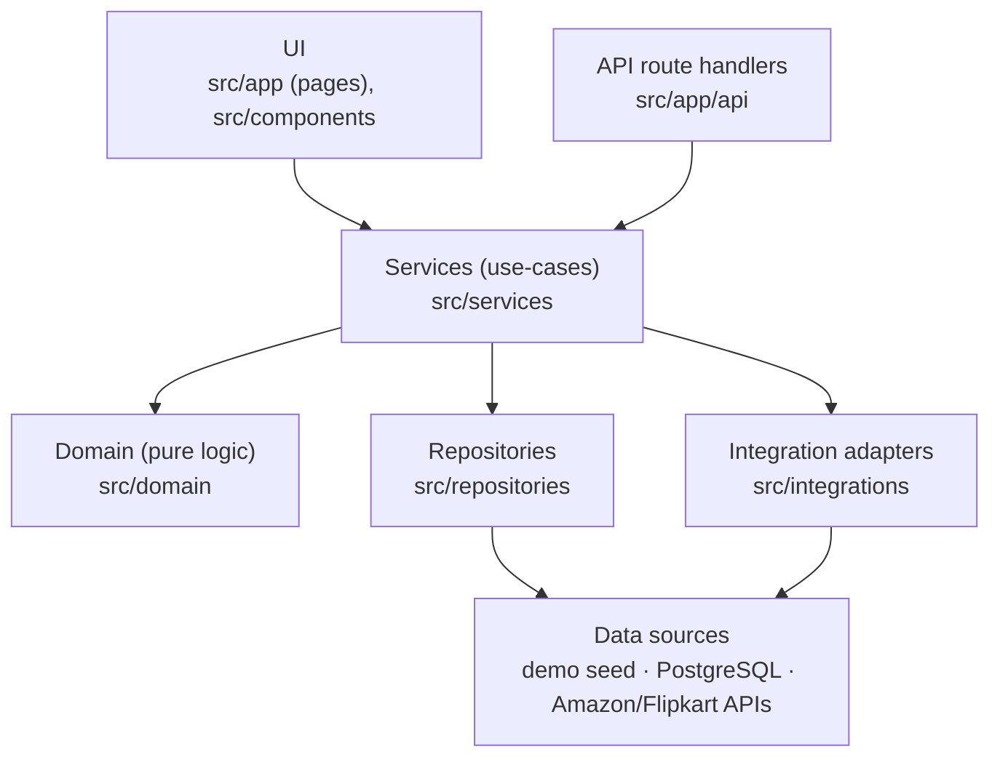
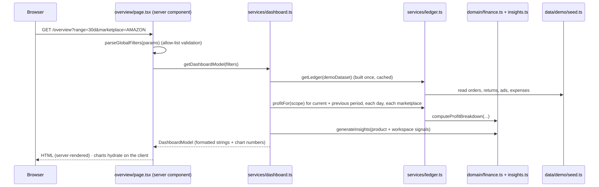
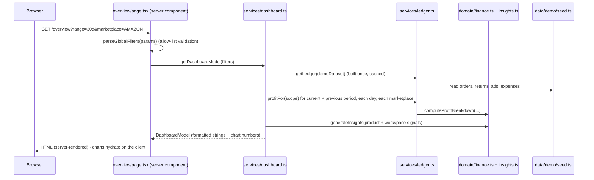
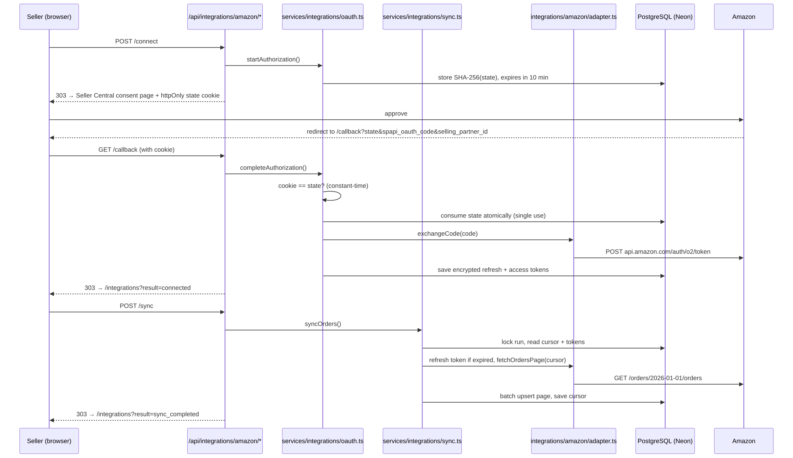
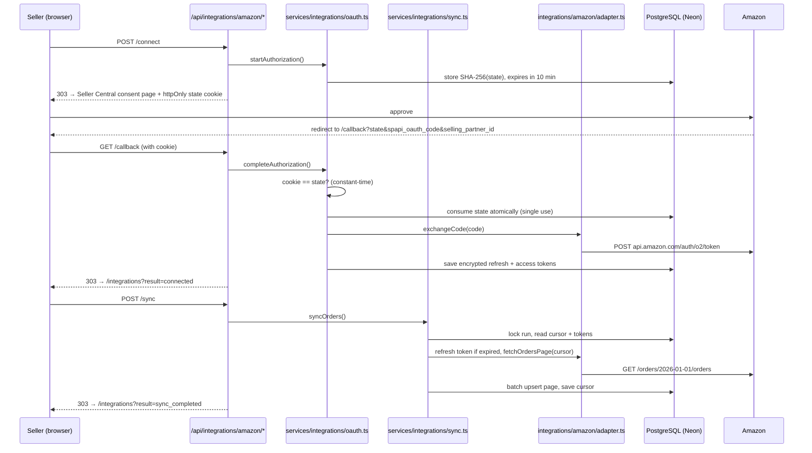

# 3. Architecture

> Detailed diagrams for every part of the system are in [`architecture/`](architecture/README.md).

## 3.1 Layers

The code is split into layers that depend **inward only**. Outer layers may import inner ones; inner layers never import outer ones.



<details>
<summary>Diagram source (Mermaid): edit here, then run <code>npm run docs:diagrams</code></summary>



</details>

| Layer | Folder | Responsibility | Must NOT |
|-------|--------|----------------|----------|
| **UI** | `src/app/(app)`, `src/components` | Render, local UI state, accessibility, loading/empty/error states | Calculate money, call the database, call providers |
| **API routes** | `src/app/api` | Validate requests, check origin, call a service, redirect or respond | Contain business logic |
| **Services** | `src/services` | Orchestrate: fetch data, apply domain logic, return **display-ready** models | Render UI |
| **Domain** | `src/domain` | Financial formulas, insight rules. Pure functions, no I/O, fully tested | Import from services, repositories or UI |
| **Integrations** | `src/integrations` | Talk to Amazon/Flipkart: OAuth, HTTP, map payloads to our types | Know about the database or UI |
| **Repositories** | `src/repositories` | Read/write the database, always scoped by `workspaceId` | Contain business formulas |

### Why this matters in practice

- A page like `/overview` calls **one** service function (`getDashboardModel`) and gets back formatted strings (`"₹1,23,455"`) and plain numbers for charts. The page never adds two amounts together.
- Swapping the demo data for real data later only changes the service layer. The pages stay the same.
- Domain functions can be tested exhaustively without a browser, database or network.

## 3.2 Folder map

```
src/
├── app/
│   ├── layout.tsx                 Root HTML, Inter font, tooltip provider
│   ├── page.tsx                   Redirects / → /overview
│   ├── globals.css                Tailwind base + a few global rules
│   ├── (app)/                     Route group: everything inside the app shell
│   │   ├── layout.tsx             Wraps pages in <AppShell> (sidebar + top bar)
│   │   ├── loading.tsx            Skeleton shown while a page renders
│   │   ├── error.tsx              Error boundary with "Try again"
│   │   ├── not-found.tsx          404 inside the shell
│   │   └── <section>/page.tsx     One folder per sidebar item
│   └── api/
│       ├── reports/[report]/route.ts            CSV downloads
│       └── integrations/[provider]/
│           ├── connect/route.ts                 POST → start OAuth
│           ├── callback/route.ts                GET  ← marketplace redirects here
│           ├── sync/route.ts                    POST → run one sync pass
│           └── disconnect/route.ts              POST → delete tokens
├── components/
│   ├── ui/            Primitives: Button, Card, Table, Badge, Tooltip, Pagination, SortHeader, TabLinks…
│   ├── layout/        AppShell, SidebarNav, MobileNav, TopBar, GlobalFilters, Logo
│   ├── dashboard/     KpiCard, RevenueProfitChart, ProfitWaterfall, MarketplaceTable, InsightsList
│   ├── charts/        Chart palette + Sparkline
│   ├── orders/        Order source tabs + synced orders view
│   └── integrations/  Marketplace card, result notice, pending form
├── data/demo/
│   ├── catalog.ts     25 product definitions, marketplace rate card, anchor date
│   ├── seed.ts        Deterministic generator for the whole demo dataset
│   ├── rng.ts         Seeded random number generator (mulberry32)
│   └── types.ts       Demo record types
├── domain/
│   ├── money.ts       Money class, INR formatting (Indian digit grouping)
│   ├── finance.ts     Profit formulas, rates, stock math, allocation
│   └── insights.ts    Deterministic "Needs your attention" rules
├── integrations/
│   ├── types.ts       The shared MarketplaceAdapter interface ("port")
│   ├── http.ts        HTTP client: timeouts, retries, safe errors
│   ├── money.ts       Parse provider amounts into Decimal
│   ├── amazon/        Amazon adapter + Zod response schemas
│   └── flipkart/      Flipkart adapter + Zod response schemas
├── lib/
│   ├── dates.ts           IST day keys, date ranges, formatting
│   ├── search-params.ts   Safe parsing of URL query params
│   ├── url.ts             Build links that keep the current filters
│   ├── marketplaces.ts    Marketplace labels and filter values
│   ├── navigation.ts      Sidebar items + which filters each page supports
│   ├── pagination.ts      Paging + null-safe sort comparator
│   ├── csv/               CSV writer with formula-injection protection
│   ├── env.ts             Zod-validated server env vars
│   ├── db.ts              Prisma client singleton (null if no DATABASE_URL)
│   ├── crypto/            AES-256-GCM token encryption, hashing
│   └── http/              Same-origin check + safe redirects for API routes
├── repositories/
│   ├── integration-repository.ts          Interface (the contract)
│   ├── prisma-integration-repository.ts   PostgreSQL implementation
│   └── memory-integration-repository.ts   In-memory implementation (tests)
├── services/
│   ├── ledger.ts         ★ Turns demo records into financial "facts"; every analytics page uses it
│   ├── dashboard.ts      Overview model (KPIs, trend, waterfall, marketplace rows, insights)
│   ├── products.ts       Per-product performance + stock position
│   ├── profitability.ts  Profit Analytics page model
│   ├── inventory.ts      Products & Inventory page model
│   ├── orders.ts         Demo orders list + order detail
│   ├── settlements.ts    Settlements page model
│   ├── returns.ts        Returns page model
│   ├── advertising.ts    Advertising page model
│   ├── reports.ts        Report catalogue + CSV table builders
│   ├── workspace.ts      Current workspace (fixed today; will come from login)
│   ├── integration-cards.ts   Static cards (demo data, CSV, Shopify placeholder)
│   └── integrations/     OAuth flow, sync engine, status, synced orders listing
├── generated/prisma/     Prisma client (generated; gitignored)
└── types/css.d.ts        Lets TypeScript accept `import "./globals.css"`
```

## 3.3 How a page request flows (example: Overview)



<details>
<summary>Diagram source (Mermaid): edit here, then run <code>npm run docs:diagrams</code></summary>



</details>

Key points:
- **URL is the state.** Filters live in the query string (`range`, `start`, `end`, `marketplace`, `status`, `q`, `sort`, `dir`, `page`). Links are shareable, the back button works, and pages work without JavaScript.
- **Every URL param is untrusted.** `src/lib/search-params.ts` validates each one against an allow-list and falls back to a safe default.
- **Only charts and a few controls are client components** (`"use client"`). Everything else renders on the server.

## 3.4 How marketplace sync flows



<details>
<summary>Diagram source (Mermaid): edit here, then run <code>npm run docs:diagrams</code></summary>



</details>

Full details in [Marketplace integrations](07-marketplace-integrations.md).

## 3.5 Important design decisions (and why)

| Decision | Why |
|----------|-----|
| **One ledger for all analytics** (`services/ledger.ts`) | Every page and report aggregates the same per-line facts with the same formulas, so totals always agree across pages. Tests prove they reconcile. |
| **Services return formatted strings** | UI cannot accidentally do money math; formatting rules (₹, Indian grouping, rounding) live in one place. |
| **IST day keys instead of `Date` comparisons** (`lib/dates.ts`) | A "7 days" range must mean 7 whole days in India regardless of the server's timezone. Ranges compare `"YYYY-MM-DD"` strings. |
| **Adapters behind one interface** (`integrations/types.ts`) | Adding Shopify means writing one new adapter; the OAuth flow, sync engine, UI and database stay unchanged. |
| **Repository interface with two implementations** | Services are tested with the in-memory repository (fast, no network). The Prisma implementation is tested separately against a real database. |
| **Demo and synced data are never mixed** | Users must always know whether a number is simulated or real. |
| **Server-rendered, URL-driven filters** | Shareable links, working back button, no client state bugs, works without JS. |

## 3.6 Conventions

- **File names:** `kebab-case.ts(x)`. **Components:** `PascalCase`. **Constants:** `SCREAMING_SNAKE_CASE` only for true constants.
- **Imports:** use the `@/` alias (maps to `src/`).
- **Tests:** next to the code (`*.test.ts`), or in `__tests__/` for integrations. Real-database tests end in `.db.test.ts` and are opt-in.
- **No `any`.** Prefer `unknown` + Zod. Avoid `as` casts and `!` assertions except where documented.
- **Errors shown to users** are allow-listed messages, never raw exception or provider text.
