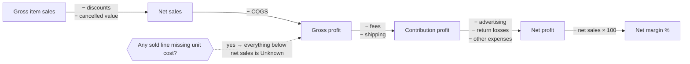
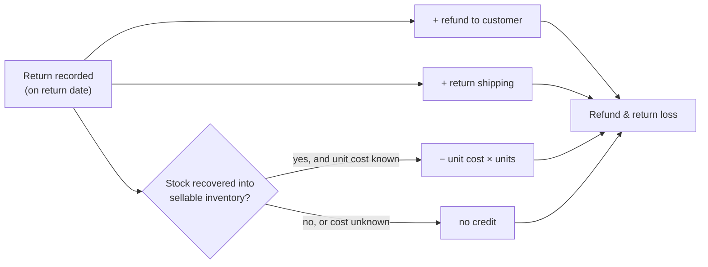
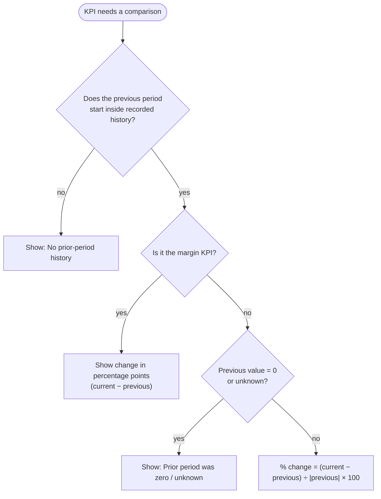

# 4. Financial logic

Everything here is implemented in `src/domain/` and `src/services/ledger.ts`, and covered by tests. If you change a formula, change the tests and this document in the same pull request.

## 4.1 Money handling

| Rule | Implementation |
|------|----------------|
| Money is stored as **integer paise** (₹1 = 100 paise) | `Money.minor` is a `Decimal` of paise |
| All arithmetic uses **`decimal.js`**, never JS `number` | `Money.add / sub / mul`, precision 28, `ROUND_HALF_UP` |
| Multiplication rounds to whole paise, half-up | `Money.mul()` → `toDecimalPlaces(0)` |
| Mixing currencies throws | `assertSameCurrency()` |
| Currency is explicit | Defaults to `INR` |
| Unknown amounts are `null`, never `0` | e.g. `grossProfit(): Money \| null` |

```ts
// ✅ correct
const net = Money.fromMinor(129900).mul(2).sub(Money.fromMinor(5000));

// ❌ never
const net = 1299 * 2 - 50;
```

### Display formatting (`formatInr`, `formatInrCompact`, `formatPercent`)

- **Indian digit grouping:** `₹1,23,45,678.90` (lakh/crore), via `groupIndian()` on the digit string, never on floats.
- `decimals: 0` rounds half-up to whole rupees for dense dashboards; detail views show paise.
- Negatives use a true minus sign: `−₹4,200`. Rounding to zero never shows `−₹0`.
- Compact for chart axes: `₹950`, `₹12.4K`, `₹3.2L`, `₹1.1Cr`.
- `null` renders as `—` or `Unknown`, never `₹0`.

Chart components receive plain `number`s (rupees) **for drawing only**. Axis labels use `compactInrTick()` in `components/charts/chart-theme.ts`, which is display formatting of values already calculated by services.

## 4.2 Sign conventions

- Sales, discounts, cancellations, COGS, fees, shipping, ads, expenses and refunds are stored as **non-negative magnitudes**. Signs are applied by the formulas.
- **Settlement difference = actual received − expected.**
  - **Negative** = the marketplace underpaid you.
  - **Positive** = an unexplained additional credit. It must be confirmed before being treated as income.
- **GST** collected on behalf of the government is **not revenue**. Demo prices are treated as tax-exclusive item values; synced Amazon tax breakdowns are excluded from item value.
- **Settlement payouts are cash movements, never sales.**

## 4.3 Profit formulas (`src/domain/finance.ts`)



<details>
<summary>Diagram source (Mermaid): edit here, then run <code>npm run docs:diagrams</code></summary>



</details>

```
Net sales              = gross item sales − discounts − cancelled item value
Gross profit           = net sales − COGS
Contribution profit    = gross profit − marketplace fees − shipping & fulfilment − other variable costs
Operating net profit   = contribution profit − advertising − other operating expenses − refund & return losses
Net profit margin (%)  = operating net profit ÷ net sales × 100
```

| Edge case | Behaviour |
|-----------|-----------|
| Any sold line is missing a unit cost | COGS = `null` → gross, contribution and net profit = `null`, margin = `null`, coverage = `"incomplete"` |
| Net sales is zero or negative | Margin = `null` (shown as `—`) |
| Profit is negative | Allowed; shown in red with a minus sign |
| Discounts vs cancellations | `discounts` covers **kept** lines only; `cancelledItemValue` is the post-discount value of cancelled lines, so nothing is subtracted twice |

Every result carries a **coverage** flag: `"estimated"` (management-accounting estimate, not audited) or `"incomplete"` (data missing). The UI shows it.

## 4.4 Accounting policies

| Topic | Policy |
|-------|--------|
| **When sales count** | On the order date (IST). Cancelled lines are removed through `cancelledItemValue`. Returned orders stay in net sales. |
| **Returns** | Counted on the **return date**. Loss = refund + return shipping − cost of stock recovered into sellable inventory. Original COGS is not reversed separately, so recovered stock is the only credit and nothing is double-counted. |
| **Return without known unit cost** | No recovery credit is taken (conservative). |



<details>
<summary>Diagram source (Mermaid): edit here, then run <code>npm run docs:diagrams</code></summary>



</details>
| **Shipping allocation** | Order-level shipping is split across lines in proportion to line value, using the **largest-remainder** method (`allocateProportionally`) so the parts always add up to the exact paise total. |
| **Advertising attribution** | To the campaign's product and marketplace. |
| **Expenses with a marketplace** (e.g. Amazon storage fees) | Count toward that marketplace. |
| **Shared overhead** (marketplace = `null`, e.g. packaging, software) | Counts **only** in "All marketplaces" totals. It is **not** allocated to marketplaces or products. The marketplace table shows it as its own "Shared overhead" row, so the rows add up exactly to the total. |
| **Product-level net profit** | Excludes shared overhead. Profit Analytics shows the reconciliation: *Σ product net profit − unallocated expenses = workspace net profit*. |

## 4.5 The ledger (`src/services/ledger.ts`)

The ledger converts raw demo records into **facts** once, then every page aggregates those facts:

| Fact | Built from | Key fields |
|------|-----------|------------|
| `LineFact` | each order line | day (IST), marketplace, productId, cancelled, units, gross, discount, cogs, fees, allocated shipping |
| `ReturnFact` | each return | day, units, refund, return shipping, recovered cost, loss |
| `AdFact` | each ad metric row | day, marketplace, productId, spend, attributed sales |
| `ExpenseFact` | each expense | day, marketplace (or null), amount |

Main functions:
- `profitFor(ledger, scope)` → `ProfitBreakdown` for any `{ range, marketplace, productId? }`.
- `unitStatsFor(ledger, scope)` → orders, sold units, returned units, return rate.
- `adTotalsFor`, `scopedLines`, `scopedReturns`, `scopedAds`, `scopedExpenses`.
- `isRangeCovered(ledger, range)` → whether a period falls inside recorded history.

The ledger is cached per dataset with a `WeakMap`, so it is built once per server process.

## 4.6 KPIs on the Overview

| KPI | Definition | Comparison |
|-----|-----------|------------|
| **Net sales** | See formula above | % change vs the previous period of equal length |
| **Gross profit** | Net sales − COGS | % change |
| **Net profit** | Operating net profit | % change |
| **Net profit margin** | Net profit ÷ net sales × 100 | Change in **percentage points (pp)**, not % |
| **Inventory value** | Sellable units (on hand − reserved) × unit cost, all channels | None: a snapshot with no history yet |
| **Settlement pending** | Expected proceeds for shipped/delivered orders not yet paid out, as of the last sync | None; shows count, oldest age, and how many differences are in review |

### Comparison rules (`percentChange`, `percentagePointChange`)



<details>
<summary>Diagram source (Mermaid): edit here, then run <code>npm run docs:diagrams</code></summary>



</details>

- % change = (current − previous) ÷ **|previous|** × 100. Using the absolute value keeps the direction truthful when the previous period was a loss: going from −₹100 to −₹50 shows **+50%** (an improvement).
- If previous = 0 → **"Prior period was zero"**; no percentage is invented.
- If the previous period **falls before the demo history starts** → **"No prior-period history"**. For example, 90 days vs the 90 before it, when only 95 days of data exist. This prevents a fake "+900%".
- Sparklines show daily values. Days where a value is unknown appear as gaps, not zeros.

## 4.7 Other calculations

| Metric | Formula | Edge cases |
|--------|---------|-----------|
| Available stock | on hand − reserved | Can be negative (oversold); valued at 0 |
| Inventory value | max(0, available) × unit cost | Unknown cost → `null` |
| Sales velocity | units sold in the **last 30 days, all channels** ÷ 30 | Needs **≥ 3 orders** and > 0 units, otherwise "Insufficient sales history" |
| Days of cover | available ÷ velocity | `null` without velocity |
| Return rate | returned units ÷ sold units × 100 (**unit-level**, never order-level) | Sold = 0 → `null` |
| ROAS | attributed sales ÷ ad spend | Spend = 0 → `null` |
| ACOS | ad spend ÷ attributed sales × 100 | Attributed = 0 → `null` |
| Estimated unit contribution | price − unit cost − commission − fixed fee − shipping, on the product's **least profitable** channel | Before ads and returns; an estimate, not realised profit |

## 4.8 The profit waterfall

Built in `dashboard.ts › buildWaterfall`. Each bar is a `[low, high]` range in rupees:

1. **Net sales** (blue, from 0)
2. COGS, Marketplace fees, Shipping & fulfilment, Advertising, Refund & return losses, Other expenses (grey, each floating down from the running total)
3. **Net profit** (green if ≥ 0, red with a "Loss" reading if negative)

If COGS is unknown, the chart is replaced by an explanation instead of a misleading picture.

## 4.9 Insight rules ("Needs your attention")

Implemented in `src/domain/insights.ts`. Every rule is deterministic, uses only real data, and stays silent when the data does not support it. Thresholds live in `DEFAULT_INSIGHT_THRESHOLDS` and are shown on the Settings page.

| Rule | Fires when | Severity |
|------|-----------|----------|
| **Stock-out risk** | Known velocity and days of cover ≤ 14 | Critical if ≤ 7 days **or** the product is in the top 25% by profit; otherwise warning |
| **Below reorder point** | Available ≤ reorder threshold but sales history is insufficient to forecast | Info |
| **Loses money after advertising** | Net loss ≥ **₹500**, profitable before ads, and ad spend > 0 | Critical |
| **High revenue, low margin** | In the top 25% by net sales with net margin between 0% and 5% | Warning |
| **High return rate** | Return rate ≥ 15% with ≥ 5 units sold | Warning |
| **Settlement discrepancy** | Any received transaction differs from expected | Warning |
| **Ad spend outpacing sales** | Ad spend up ≥ 20% while net sales moved within ±5% (needs prior-period history) | Warning |

Every insight has a stable ID (`rule:entity`, which prevents duplicates), a severity, a title, evidence with real numbers, a metric, an estimated impact where calculable, a recommended action, and a link to the relevant page (filters preserved). Results are sorted by severity, then by impact.

**The ₹500 materiality threshold** exists because the first version flagged a ₹7 loss as "critical".

## 4.10 Synced marketplace money

Provider amounts are parsed by `src/integrations/money.ts › parseAmount`:

- Amazon sends **decimal strings** (`"1299.00"`), which are parsed exactly.
- Flipkart sends **JSON numbers**. These are converted through their string form and rounded half-up to paise (e.g. `499.995` → `500.00`).
- Anything missing or malformed → `null` ("Not priced yet by the marketplace").
- Amazon item value = `ITEM` proceeds − |`DISCOUNT`| (tax excluded). Amazon does not document the sign of `DISCOUNT`, so its magnitude is used.
- Flipkart `flipkartDiscount` is funded by Flipkart, **not** the seller, so it is not treated as a seller discount (discount = unknown).
- Stored as `DECIMAL(14,2)` with an explicit `currency` column. Non-INR values are shown as-is, labelled "Not converted to INR".
