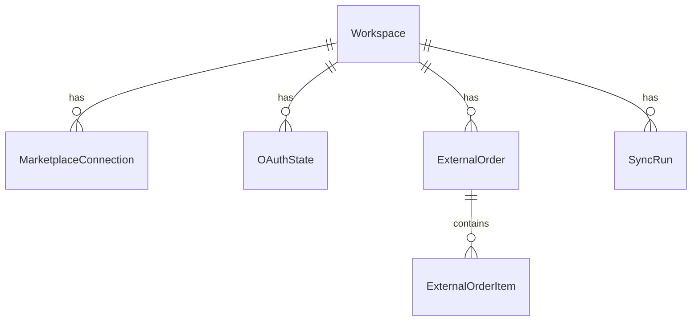

# 8. Database

## 8.1 Overview

| Item | Value |
|------|-------|
| Engine | PostgreSQL 18 on **Neon** (dev database in `us-east-2`, Ohio) |
| ORM | **Prisma 7.10** with the `pg` **driver adapter** (`@prisma/adapter-pg`); no native query-engine binary |
| Schema | `prisma/schema.prisma` |
| Migrations | `prisma/migrations/` (SQL, committed) |
| CLI config | `prisma.config.ts` (Prisma 7 moved the datasource URL here) |
| Generated client | `src/generated/prisma/` (gitignored; created by `prisma generate`) |
| Client singleton | `src/lib/db.ts › getPrisma()`; returns `null` when `DATABASE_URL` is unset |

**What is stored today:** only marketplace connections and synced orders. The demo analytics data is **not** in the database.

## 8.2 Tables



| Table | Purpose | Key constraints |
|-------|---------|-----------------|
| `Workspace` | Tenant boundary. Every other table references it (`ON DELETE CASCADE`). | PK `id` |
| `MarketplaceConnection` | One authorised seller account per provider per workspace. Tokens are **ciphertext only**. Holds the sync cursor (`syncState` JSON) and last sync outcome. | **Unique `(workspaceId, provider)`** |
| `OAuthState` | Short-lived, single-use OAuth `state`. Only a **SHA-256 hash** is stored. | **Unique `stateHash`**; index on `expiresAt` |
| `ExternalOrder` | Synced order header: dates, status, raw provider status, fulfilment, currency, item value, discount, units. **No buyer PII.** | **Unique `(workspaceId, provider, externalOrderId)`**; indexes on `(workspaceId, orderedAt)` and `(workspaceId, provider, status)` |
| `ExternalOrderItem` | Line items: SKU, ASIN/FSN, title, quantity, unit price, line value, provider status | **Unique `(orderId, externalItemId)`** |
| `SyncRun` | One row per sync attempt: status, timings, fetched/created/updated counts, safe message | Index on `(workspaceId, provider, startedAt)` |

Enums: `MarketplaceProvider` (AMAZON, FLIPKART), `ConnectionStatus` (CONNECTED, REAUTH_REQUIRED, DISCONNECTED), `SyncStatus` (RUNNING, SUCCEEDED, PARTIAL, FAILED), `OrderStatus` (PENDING … RETURNED).

Money columns are `DECIMAL(14,2)` with an explicit `currency CHAR(3)`.

## 8.3 Repository layer

`src/repositories/integration-repository.ts` is the contract. **Every method takes a `workspaceId`** and must never return another workspace's rows.

| Method | Notes |
|--------|-------|
| `ensureWorkspace` | Upsert |
| `createOAuthState` / `consumeOAuthState` | Consume is an atomic conditional update: one winner only |
| `getConnection` / `listConnections` / `saveAuthorizedConnection` / `updateConnection` | Saving a new authorisation resets the sync cursor |
| `getOrder` / `getOrders` | `getOrders` reads a whole page of orders in **one** query |
| `saveOrders` | Bulk upsert of a page in **one transaction** (see 8.5) |
| `listOrders` | Filters, sort, pagination and status counts for the Orders tab |
| `tryStartSyncRun` / `finishSyncRun` | Prevents concurrent syncs per connection |

Two implementations:
- `PrismaIntegrationRepository`: production (PostgreSQL).
- `MemoryIntegrationRepository`: used by service tests. Same behaviour, no database.

## 8.4 Migrations

```bash
npm run db:migrate        # apply pending migrations (safe for production)
npm run db:migrate:dev    # create a new migration from schema changes (development only)
```

- Migrations use `DIRECT_DATABASE_URL` (non-pooled). The app uses `DATABASE_URL` (pooled).
- `prisma.config.ts` loads `.env.local` for CLI commands, because Prisma 7 does not read env files.
- The first migration (`20261011000000_marketplace_integrations`) was generated **offline** with `prisma migrate diff --from-empty`, then applied to the Neon dev database.
- **Never edit an applied migration.** Create a new one.

## 8.5 Bulk upsert and the timezone trap (read before touching `saveOrders`)

`saveOrders` writes a page of orders in a fixed number of statements, however many orders there are:

1. `INSERT … VALUES (…),(…) ON CONFLICT (workspaceId, provider, externalOrderId) DO UPDATE … RETURNING id, externalOrderId, (xmax = 0) AS inserted`. The `xmax = 0` trick tells inserts from updates.
2. `DELETE FROM "ExternalOrderItem" WHERE "orderId" IN (…)`
3. `INSERT … VALUES …` for items, in chunks of 1,000 rows (PostgreSQL allows at most 65,535 bind parameters).

It is all **parameterised** through `Prisma.sql` / `Prisma.join`; no string concatenation. Duplicate external IDs in one batch are rejected (PostgreSQL cannot update the same row twice in one statement). The sync engine merges duplicates before saving.

> ⚠️ **Timezone trap.** The timestamp columns are `TIMESTAMP(3)` **without time zone** (Prisma's default). When you pass a JS `Date` to a raw query, the `pg` driver serialises it in the **server's local timezone**, and PostgreSQL drops the offset. On a server running in IST, every order date would shift by **5h30m**.
>
> **Rule:** in raw SQL, always pass `date.toISOString()` and cast with `::timestamptz AT TIME ZONE 'UTC'` (see the `utc()` helper). The real-database test runs with `TZ=Asia/Kolkata` and `TZ=UTC` to catch this.

Prisma's normal query API (`findMany`, `create`…) handles timezones correctly. The trap only applies to `$queryRaw` / `$executeRaw`.

## 8.6 Performance notes

- Measured round trip from the development machine to the Neon `us-east-2` database: **~230 ms**.
- Saving a 100-order page: **~1.8 s** (batched) vs **~2.5 min** (one order at a time).
- Neon's free tier **suspends idle compute**, so the first query after a pause takes several seconds.
- Interactive transactions use `timeout: 30_000, maxWait: 10_000` to tolerate slow links.
- The pg pool is limited to `max: 3` connections per serverless instance; use Neon's **pooled** URL for the app.

## 8.7 Real-database tests

`src/repositories/prisma-integration-repository.db.test.ts` runs only with `npm run test:db` (`RUN_DB_TESTS=1` + `.env.local`). It:

- creates a throwaway workspace `ws_dbtest_<random>` and **deletes it afterwards** (cascade);
- proves OAuth state is single-use under **concurrent** consumption;
- round-trips the JSON sync cursor and `null`;
- bulk-saves **100 orders**, re-saves them as updates, and checks exact decimals, UTC timestamps (to the millisecond), item replacement, titles with quotes/commas, duplicate rejection, filtering, sorting and status counts;
- proves a concurrent sync run is blocked.

Run it after any change to `prisma/` or `src/repositories/`.
