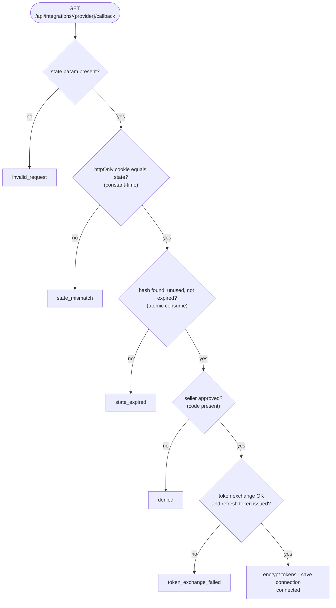

# 9. Security

## 9.1 ⚠️ The biggest open gap: there is no login

- Anyone who can reach the app can view every page, **connect a marketplace account** and **read synced orders**.
- `services/workspace.ts › getCurrentWorkspace()` returns a fixed workspace (`ws_acme_india`).
- All database queries are **already scoped by `workspaceId`**, and the workspace always comes from the server, never from the request. Adding login is therefore mostly a change to that one function, which must then return the signed-in member's workspace (verified server-side).

**Until login exists, do not configure real marketplace credentials on a publicly reachable deployment.** Local development is fine.

## 9.2 Controls in place

How the OAuth callback decides whether to trust a request:

Diagram source (Mermaid): edit here, then run <code>npm run docs:diagrams</code>

| Threat | Control | Where |
|--------|---------|-------|
| Stolen database contents expose seller tokens | Tokens encrypted with **AES-256-GCM** (random 12-byte IV, auth tag; tampering fails). Key only in env. | `lib/crypto/token-cipher.ts` |
| Tokens or secrets leak through logs/UI | Provider errors carry only a classification (`unauthorized`, `rate_limited`…); response bodies are never placed in messages. UI shows allow-listed messages only. | `integrations/http.ts`, `result-notice.tsx` |
| OAuth CSRF / login CSRF (attacker attaches their account) | 256-bit `state`, stored hashed, 10-minute expiry, **single use** (atomic), **bound to the browser** via an httpOnly cookie, compared in constant time | `services/integrations/oauth.ts`, `connect/route.ts` |
| Cross-site form posts (connect, sync, disconnect) | POST-only routes; `Origin` header must match the app | `lib/http/request-guards.ts` |
| OAuth state created by link prefetching | Connect is POST-only (GET → 405) | `connect/route.ts` |
| Referrer leaking codes | `Referrer-Policy: no-referrer` on OAuth responses | `request-guards.ts`, `connect/route.ts` |
| Bearer token sent to another host | Flipkart `nextPageUrl` must be on the configured host | `flipkart/adapter.ts` |
| Malformed or hostile provider responses | Every response is validated with **Zod**; invalid → `bad_response`, nothing saved | `*/schemas.ts` |
| SQL injection | Prisma query API; raw SQL only via parameterised `Prisma.sql` / `Prisma.join` | `prisma-integration-repository.ts` |
| Tampered URL params | Allow-list parsing; length limits on search text; unknown values fall back to defaults | `lib/search-params.ts` |
| Reflected content | Result codes mapped to fixed text; numbers validated with a regex | `result-notice.tsx` |
| CSV formula injection in exports | Cells starting with `= + - @ \t \r` are prefixed with `'` (plain numbers allowed) | `lib/csv/index.ts` |
| Unnecessary personal data | Amazon `BUYER`/`RECIPIENT` datasets never requested; no buyer fields stored; demo customer refs are synthetic | adapters, schema |
| Database connection downgrade | Neon URLs use `sslmode=verify-full` | `.env.local` |
| Secrets in git | `.env`, `.env.local`, `src/generated` gitignored; commits scanned before pushing | `.gitignore` |
| Concurrent syncs corrupting state | A sync-run lock per connection | `tryStartSyncRun` |
| Marketplace passwords | Never requested; only official OAuth consent flows | — |
| Internal docs exposed publicly (they describe architecture and known gaps) | `/internal` is 404 in production unless `INTERNAL_DOCS_PASSWORD` is set, then HTTP Basic with constant-time compare; `noindex` + `no-store` | `src/middleware.ts`, `src/internal/access.ts` |

## 9.3 Secrets handling rules

1. Secrets live only in `.env.local` (local) or the hosting provider's environment settings. **Never** in code, docs, tickets or chat.
2. If a secret is exposed, **rotate it**. The Neon database password was shared in a chat during setup; reset it in Neon (Roles → `neondb_owner`) and update `.env.local`.
3. `TOKEN_ENCRYPTION_KEY`: rotating it makes stored tokens unreadable, so sellers must reconnect. Key versioning (`v1.` prefix) is in place for a future rotation scheme.
4. Use separate credentials and databases for development and production.

## 9.4 Known gaps (beyond login)

| Gap | Risk | Suggested fix |
|-----|------|---------------|
| No authentication or roles | Anyone can connect/read | Auth.js (Google or email), workspace membership checks |
| No rate limiting on our own routes | Sync/connect could be spammed | Per-IP or per-user limits (e.g. Upstash) |
| Sync-run lock is check-then-insert | Two simultaneous requests could both start (rare) | Partial unique index on `SyncRun (workspaceId, provider) WHERE status = 'RUNNING'` |
| No audit log | Connects/disconnects aren't recorded with an actor | `AuditLog` table once users exist |
| No Content-Security-Policy headers | Defence-in-depth against XSS | Add CSP in `next.config.ts` |
| Amazon Data Protection Policy | Production apps handling Amazon data must meet Amazon's requirements | Review before publishing the app |
