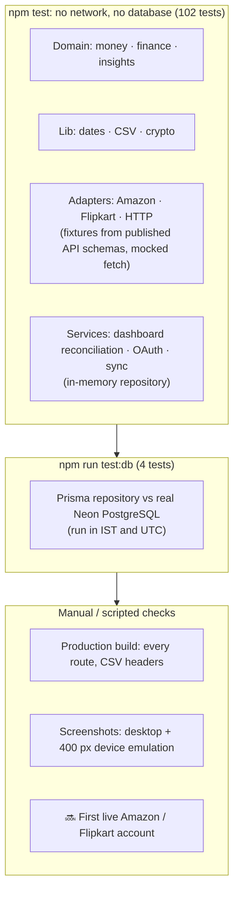

# 10. Testing & quality

## 10.1 Test suites



<details>
<summary>Diagram source (Mermaid): edit here, then run <code>npm run docs:diagrams</code></summary>



</details>

| Command | What runs | Needs |
|---------|-----------|-------|
| `npm test` | **144** unit and service tests (Vitest) | Nothing (no network, no database) |
| `npm run test:db` | **4** real-database tests | `.env.local` with `DATABASE_URL` |

### What is covered

| File | Covers |
|------|--------|
| `domain/money.test.ts` | Exact paise arithmetic, half-up rounding, Indian grouping, negatives, compact format, unknown → fallback |
| `domain/finance.test.ts` | Full profit chain, missing COGS → unknown, negative profit, zero/negative sales margin, % change against a negative base, pp change, settlement sign, stock and inventory edge cases, insufficient history, ROAS/ACOS/return rate zero denominators, largest-remainder allocation, unit contribution |
| `domain/insights.test.ts` | Each rule fires and stays silent correctly, materiality threshold, no ad blame without ad spend, minimum sample for return rate, prior-period requirement, severity sort, no duplicate IDs |
| `lib/dates.test.ts` | Whole-day IST presets, custom range validation and fallback, previous range, IST bucketing at the midnight boundary, Monday weeks |
| `lib/csv/csv.test.ts` | Formula-injection escaping, numbers stay numeric, quoting |
| `services/dashboard.test.ts` | Seed reproducibility and shape; **net sales recomputed independently from raw orders**; empty dataset → ₹0; filters change figures; no fake comparison for 90 days; **marketplace rows + overhead = total**; **product totals reconcile**; P&L export = dashboard; every report builds; insights link to real routes |
| `lib/crypto/token-cipher.test.ts` | Round trip, fresh IV, tamper and wrong-key rejection, key validation |
| `integrations/__tests__/http.test.ts` | Retry honouring `Retry-After`, no retry on 401, OAuth `invalid_grant` → unauthorized (revoked access), no secrets in errors, bounded network retries, non-JSON bodies |
| `integrations/__tests__/amazon.test.ts` | India consent URL (+ `version=beta`), callback parsing, LWA form exchange, EU endpoint, **no PII datasets requested**, money mapping, status mapping, unpriced orders, pagination + resume, malformed responses, cursor validation |
| `integrations/__tests__/flipkart.test.ts` | Authorize URL, Basic auth + real state in the exchange, all six segments + `nextPageUrl`, **foreign-host rejection**, grouping, IST dates, float → paise, status derivation, cancelled-item exclusion |
| `services/views.test.ts` | Orders (counts, filters, search, sort, pagination, detail profit chain), inventory (status, honest forecasts, search), settlements (status counts, signs, cross-channel totals), returns (unit rate, reasons), advertising (totals, ROAS × ACOS = 100), profitability (sort presets, losses view) |
| `services/report-views.test.ts` | Report viewer: every column typed, on-screen rows identical to the CSV across all pages, decimal-exact totals, sorting both ways, pagination, P&L matches the dashboard, numeric chart data, empty periods, filter notes |
| `internal/roadmap.test.ts` | The real roadmap file is valid and every ✅ has gate evidence; integrity rules (evidence, tests, manual QA, single next pick, blocked reasons, dependencies, cycles) |
| `services/integrations/integrations.test.ts` | OAuth: hashed state, encrypted tokens, cookie mismatch, single use, expiry, decline, exchange failure, disconnect keeps orders. Sync: not connected, page budget + resume, idempotency, in-page duplicates, cross-page item merge, token refresh, reauth on 401, rate-limit keeps progress, concurrent lock, end-to-end with the real Flipkart adapter. Listing: IST range, provider filter, unpriced display, workspace isolation. Status: missing-config names, connected only with stored tokens. |
| `internal/internal.test.ts` | `/internal` access gate (open in dev, 404 without password, Basic auth, wrong/malformed credentials), registry, link rewriting, **every doc link resolves**, table of contents, `.env.example` parsing |
| `repositories/prisma-integration-repository.db.test.ts` | Real PostgreSQL: concurrent single-use state, JSON cursor, **100-order bulk upsert**, UTC timestamps, decimals, item replacement, duplicate rejection, listing, sync lock |

### How provider APIs are tested without credentials

Adapter tests use **fixtures shaped exactly like each provider's published response schema** (Amazon's `orders_2026-01-01.json` model, Flipkart's Order Management v3 reference) and a mocked `fetch`. They prove our requests and mapping match the documentation. They cannot prove the live services behave as documented; that is what the checklist in [Integrations §7.9](07-marketplace-integrations.md#79-checklist-for-the-first-live-test) is for.

## 10.2 The roadmap QA gate

Roadmap steps (`docs/roadmap/roadmap.json`) are ticked done **only** by `npm run roadmap:verify -- <ID> --qa "…"`. The gate:

1. refuses if a Next.js server for this project is running (the build would corrupt its `.next`), if dependencies are unfinished, if the step is blocked, or if a feature/UI/infra/security step lists no test files;
2. runs typecheck, lint (0 warnings), the full test suite with per-file results, the production build, and `test:db` when the step `requiresDb`;
3. requires every test file listed on the step to have run and passed, and requires `--qa` notes when the step lists manual QA;
4. only then sets `done` and records evidence (time, commit, checks, per-file test counts, QA notes).

`src/internal/roadmap.test.ts` makes `npm test` fail if anyone hand-edits a step to done without valid evidence.

## 10.3 Definition of done for a change

```bash
npm run typecheck    # 0 errors (strict)
npm run lint         # 0 warnings
npm test             # all pass
npm run build        # succeeds
npm run test:db      # if you touched prisma/ or src/repositories/
```

Plus, for UI changes:
- Check the page at desktop width **and** at 400 px with real device emulation. No page may scroll sideways.
- Check the empty, loading and error states.
- No new fake buttons; anything unfinished is disabled with a reason.

## 10.4 Verification that has been done

- All pages and routes were exercised against a production build (`next start`): every nav route returns 200, CSV downloads carry correct headers, and unknown reports return 404.
- Integration routes were exercised in three configurations: **no config**, **fake credentials + unreachable database**, and **real Neon database**. Each degrades to a clear message; server logs contain no secrets.
- Security checks: cross-site POST → 403, missing Origin → 403, GET connect → 405, unknown provider → 404, no reflected text.
- Visual checks were done with headless Chrome screenshots (desktop) and DevTools-protocol device emulation (400 px). Every page was measured with `scrollWidth = 400`.

## 10.5 Not yet tested

- Live Amazon/Flipkart accounts (no credentials yet)
- End-to-end browser tests (Playwright is in the spec but not installed)
- Load and performance beyond a single 100-order page
