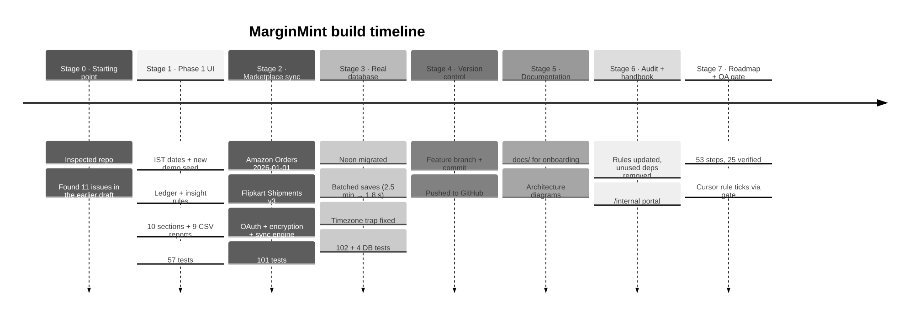
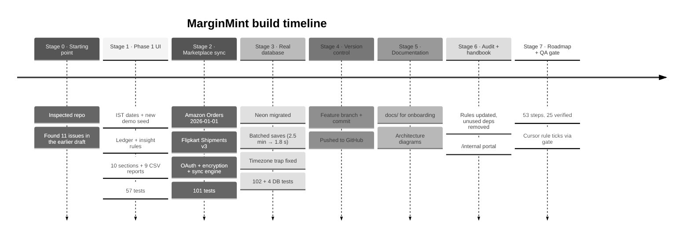

# 11. Work log: everything done so far

A chronological record of what was built, what was found, and **why** each decision was made. Newest work is at the bottom.

Diagram source (Mermaid): edit here, then run <code>npm run docs:diagrams</code>

---

## Stage 0: Starting point

- The repository already had tooling installed (Next.js, Tailwind, Recharts, `decimal.js`, Zod, Vitest), even though `AGENTS.md` still called it "greenfield".
- An earlier draft had a money module, a demo seed, a dashboard service, some UI primitives, and five page files.
- Problems found in that draft:
  1. **Hardcoded insights.** Alerts named specific products (`prd_stand`, `MM-104`) instead of being produced by rules.
  2. **Fake forecasts.** Stock-out dates used a catalog constant, not actual sales.
  3. **Double-counted overhead.** Expenses with no marketplace were added to **every** marketplace's row, so the rows summed to more than the total.
  4. **Double-counted discounts.** A cancelled line's discount was subtracted twice.
  5. **Half-day ranges.** "7 days" started at noon, used UTC instead of IST, and excluded part of the first day.
  6. **Pending payouts** were measured gross instead of net of fees, and overlapped with already-settled orders.
  7. **Missing values shown as zero** in charts and sparklines.
  8. **Fabricated comparisons.** The 90-day view would have compared against a period with almost no data and shown a huge % change.
  9. **Western digit grouping** for rupees (₹123,456 instead of ₹1,23,456).
  10. **Money math inside pages.** The draft Profitability and Settlements pages summed paise as raw numbers.
  11. **Typecheck failed:** a missing CSS module declaration and a missing component.

## Stage 1: Phase 1 UI on demo data

**Data and domain**
- Rewrote dates around **IST day keys** (`lib/dates.ts`): ranges are whole inclusive days, independent of server timezone.
- Rebuilt the demo seed (`data/demo/seed.ts`):
  - **demand-weighted** product selection;
  - multi-item orders;
  - per-line marketplace fees;
  - returns recognised on the return date;
  - settlement lag per channel;
  - an ad-spend ramp;
  - monthly expenses.
- Fixed the Indian digit grouping and added compact formats (`₹3.2L`, `₹1.1Cr`).
- Extended `domain/finance.ts`:
  - % change against |previous|;
  - percentage-point change;
  - sales velocity with a minimum-history rule;
  - largest-remainder allocation;
  - estimated unit contribution.
- Wrote the **rules engine** `domain/insights.ts` (7 rules, thresholds, deduplication, sorting).
- Created the **ledger** (`services/ledger.ts`) so every page and report uses the same facts and formulas.
- Defined the attribution policy: shipping by line value; ads by campaign SKU; shared overhead only in workspace totals, shown as its own row.

**Tuning the seed (not the formulas)**
- The first probe showed ad spend at 62% of sales and the whole business losing money, which is unrealistic. Ad budgets in the seed were reduced; the result is ~₹1.23 L net sales and ~17% net margin over 30 days.
- Settlement discrepancies were made material (₹80–₹450 each instead of a few rupees).

**UI**
- Design tokens; 20 reusable UI primitives; app shell with grouped sidebar, mobile sheet, sticky top bar and URL-driven global filters (presets + validated custom range).
- Overview:
  - 6 KPI cards with tooltips, deltas and sparklines;
  - revenue vs profit chart (daily/weekly, chart/table);
  - profit waterfall;
  - marketplace table with an overhead row;
  - insights.
- Real pages for all 10 sections, plus an order detail page, loading/error/not-found states, and 9 CSV exports with formula-injection protection.
- The chart palette was **validated with a colour-blindness tool**, not picked by eye.

**Fixes found while verifying**
- Fixed the ESLint config: `eslint-config-next@16` ships native flat config, and wrapping it in `FlatCompat` crashed.
- Added a **₹500 materiality threshold**: the T-shirt was flagged "critical" for a ₹7 loss.
- Mobile overflow, three separate causes: grid `min-width: auto`, `sr-only` text escaping an unpositioned scroll container, and a screen-reader table ignoring 1 px width.
- Discovered that desktop Chrome cannot render a true 400 px window; switched to DevTools device emulation for phone checks.
- Updated `AGENTS.md` and `README.md` to match reality.

**Result:** 57 tests passing, clean typecheck, lint and build; every route verified on a production build.

## Stage 2: Amazon & Flipkart order sync

**Decisions with the product owner**
- Scope: any seller (multi-tenant), **no login for now** (explicit decision; risk documented), Neon for the database.
- No developer credentials exist yet, so everything is built and tested against published API formats.

**Research findings that shaped the build**
- Amazon's **Orders API v0 is deprecated**; built on **Orders API `2026-01-01`** (`searchOrders`).
- Amazon India uses the **EU** endpoint and marketplace ID `A21TJRUUN4KGV`; Draft apps need `version=beta`.
- Flipkart's filter API has **no "updated since"** field, so the sync uses a rolling 30-day window across six segments.
- Flipkart's public docs leave five details unspecified. They are isolated in the adapter and marked `VERIFY IN SANDBOX`.

**Built**
- **Prisma 7.10** with the `pg` driver adapter (no native engine binary on Netlify); schema with 6 tables, an offline-generated migration.
- Adapter interface + Amazon and Flipkart adapters with Zod-validated responses; an HTTP client with retries and safe errors.
- OAuth service:
  - hashed, single-use, 10-minute `state`, bound to the browser by cookie;
  - AES-256-GCM token encryption.
- Sync engine: resumable cursors, page/time budgets for serverless, token refresh, reauth detection, run locking, item merging.
- API routes (POST-only for state changes, origin-checked) and an allow-listed result-message system.
- Integrations page with honest states; a Demo / Synced switch on the Orders tab.
- 44 new tests (101 total at this point).
- Fixed the Flipkart token exchange, which was sending a placeholder `state` instead of the real one.
- Unknown seller discounts are shown as unknown (`null`), not zero.
- Database or provider failures redirect with friendly messages instead of raw 500s.

## Stage 3: Connecting the real Neon database

- Created `.env.local` (gitignored, mode 600) with the Neon URLs, a generated encryption key and `APP_URL`.
- Switched Neon URLs to `sslmode=verify-full`: the `pg` driver warned that `require` will be weakened in its next major version.
- Made `prisma.config.ts` load `.env.local`, because Prisma 7's CLI does not.
- Confirmed the database was empty, then applied the migration.
- Added an opt-in **real-database test suite** (`npm run test:db`). It found two real problems:
  1. **Performance.** Round trips to the database took ~230 ms, and saving orders one at a time (~7 round trips each) made a 100-order page take ~2.5 minutes, far past serverless limits. Rewrote saving as a **batched, parameterised bulk upsert**: now **~1.8 s** per page.
  2. **Timezone trap.** Raw SQL with JS `Date` on `TIMESTAMP` columns would shift dates by 5h30m on IST servers. Dates are now passed as explicit UTC; the test runs in both IST and UTC.
- Verified the app reads the real database and that cleanup leaves no test rows.
- **Result:** 102 unit/service tests + 4 real-database tests passing.

## Stage 4: Version control

- Created branch **`feature/marketplace-order-sync`** and committed the work (50 files). Before committing, the staged changes were scanned for secrets; none were found. `.env.local` and the generated client are gitignored.
- `tsconfig.tsbuildinfo` (a TypeScript build cache) was intentionally left out of the commit.
- Pushed the branch to GitHub. A pull request description was prepared; the PR must be opened from the GitHub web UI because the `gh` CLI is not installed.

## Stage 5: Documentation

- Created this `docs/` folder for onboarding new engineers.
- Added `docs/architecture/` (10 pages, incl. the full product architecture) and rendered every Mermaid diagram to SVG (`npm run docs:diagrams`) so they display in VS Code and on GitHub.

## Stage 6: Audit and the internal handbook

- **Audited rules and docs.** Removed stale "once the code exists" wording from the rules; added the lessons learned (token encryption, OAuth state, raw-SQL timezone trap, provider response validation, mobile overflow fixes, Mermaid gotchas); added a `documentation.mdc` rule; normalised rule titles.
- **Removed unused things:** `date-fns`, four unused Radix packages (`dropdown-menu`, `select`, `separator`, `tabs`) and `@eslint/eslintrc` (left over from the old ESLint config). Stopped tracking `tsconfig.tsbuildinfo` (a build cache) and gitignored it.
- **Built `/internal`:** a handbook portal generated from `docs/`, `.cursor/rules/`, `AGENTS.md`, `README.md`, `MarginMint.md` and `.env.example`. It has searchable navigation, a table of contents, links between docs rewritten to portal pages, served diagrams, and an environment-variable table.
- **Access:** open in development; in production 404 unless `INTERNAL_DOCS_PASSWORD` is set (then HTTP Basic). `noindex`, `no-store`. Covered by tests.

## Stage 7: Product roadmap with QA-gated ticking

- **`docs/roadmap/roadmap.json`:** 53 steps across 7 phases, each with a detailed summary, acceptance criteria, dependencies, test files and manual QA. Statuses: done, in progress, next pick, pending, blocked, future.
- **QA gate** (`npm run roadmap:verify`): typecheck, lint, full tests with per-file results, build and DB tests; ticks only on success and records evidence. **Cursor rule** `roadmap.mdc` (always on) makes this the standard workflow.
- **Honesty fix:** six built pages had no dedicated tests, so they could not be ticked under the new rule. Added `services/views.test.ts` (13 tests) first.
- **Baseline audit:** ran the gate over all 25 built steps; every ✅ now carries evidence.
- **Gate hardening:** the first run happened while a developer's `next dev` server was running, and the gate's build shares `.next` with it. The gate now refuses to run while any Next.js server for the project is running.
- **`/internal/roadmap`:** progress, next pick / in progress / blocked, how ticking works, per-phase progress, expandable steps with evidence.

## Stage 8: Report viewer and a full review

- **Report viewer (C-12):** every report can be viewed on screen with summary figures, a chart, a sortable/paginated table with exact totals, definitions, CSV and print. Rows come from the same builder as the CSV.
- **Review: hostile input.** Probed routes with malformed dates, injected values, path traversal, huge search strings and bad sort/page params; all handled. Hardened the order page against malformed URL encoding.
- **Bug fixed (I-07):** a revoked token returns 400 `invalid_grant`, which showed "sync failed" forever. It now switches the connection to "Reconnect required" (tested end to end).
- **Bug fixed:** a stale synced-orders link past the last page showed an empty table; it now shows the last page.
- **Print:** wide report tables wrapped to fit the page instead of being cut off.
- **Tooling:** `npm run lint` uses ESLint directly (`next lint` is deprecated and removed in Next 16); Vitest config moved to `.mts` (no more CommonJS warning); `.env.example` recommends `sslmode=verify-full`.
- **Dependencies:** applied the non-breaking security patch (`sharp` 0.35.5). The remaining advisories need Next 16 / Tailwind 4, so they are tracked as roadmap step Q-06. They mostly affect build-time tooling, not the shipped app.

---

### Repository history before this work (for context)

| Commit | Summary |
|--------|---------|
| `9052384` | Design prototype |
| `e989b30` | Netlify deploy config |
| `d5e952d` | Next.js upgraded to 15.5.27 (security patch, CVE-2025-55182) |
| `0cdadee` | `tsconfig.tsbuildinfo` update |
| `26be501` | Amazon and Flipkart order sync with Prisma/Neon persistence (branch `feature/marketplace-order-sync`) |
