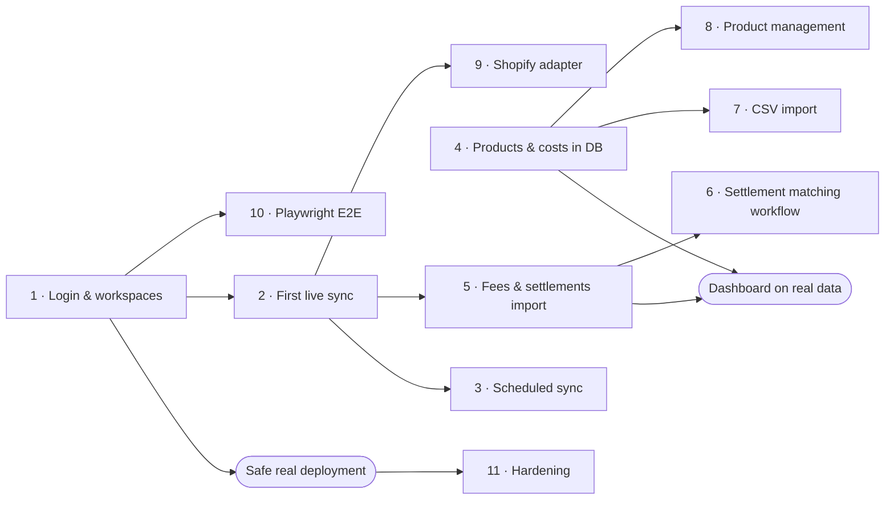

# 12. Known gaps & roadmap

> **The live, authoritative tracker is [`roadmap/roadmap.json`](roadmap/README.md)** (also at `/internal/roadmap`). Every step there has a status, acceptance criteria and QA-gate evidence. This page explains the gaps in prose.

## 12.1 Known limitations today

| # | Limitation | Impact |
|---|------------|--------|
| 1 | **No login / user accounts** | Anyone with the URL can connect accounts and read synced orders. Keep real credentials off public deployments. |
| 2 | **Marketplace sync never run against a live account** | Built against published API formats only; first live test pending credentials ([checklist](07-marketplace-integrations.md#79-checklist-for-the-first-live-test)). |
| 3 | **Flipkart behaviour partly unverified** | Five assumptions marked `VERIFY IN SANDBOX` in `flipkart/adapter.ts`. |
| 4 | **Dashboard and analytics still use demo data** | Synced orders only appear in the Orders tab; profit, KPIs and reports ignore them. |
| 5 | **No costs for synced orders** | Unit costs, fees and settlements are not imported yet, so real profit cannot be calculated. |
| 6 | **Sync is manual** | No scheduled/background sync; the user clicks "Sync orders now". |
| 7 | **No detail page for synced orders** | Demo orders have one; synced orders show a list only. |
| 8 | **Read-only analytics** | No product editing, stock adjustments, settlement review workflow or insight resolution. |
| 9 | **No CSV import** | Exports work; imports need the database layer for validation and de-duplication. |
| 10 | **Flipkart returns not synced** | `RETURN_REQUESTED`/`RETURNED` need the separate returns API. |
| 11 | **Amazon multi-seller use needs a published app** | Draft apps can only be authorised by a limited set of sellers. |
| 12 | **No end-to-end tests** | Playwright is in the spec but not installed. |
| 13 | **Inventory value has no history** | It is a snapshot; no change vs the prior period can be shown. |
| 14 | **Neon free tier cold starts** | The first request after idle takes a few seconds. |

## 12.2 Recommended next steps (in priority order)

Diagram source (Mermaid): edit here, then run <code>npm run docs:diagrams</code>

1. **Authentication & workspaces.** Auth.js (Google sign-in is simplest); `Workspace`/`WorkspaceMember` tables; make `getCurrentWorkspace()` resolve the signed-in member's workspace and reject others. Unblocks real deployment.
2. **First live sync.** Register the Amazon app (Draft), run the checklist, fix any differences ; then the Flipkart sandbox.
3. **Scheduled sync.** A Netlify Scheduled Function calling the sync engine for each connected account (the engine is already resumable and lock-protected).
4. **Move analytics to the database.** Persist products, costs, fees, settlements, returns and ads; point the ledger at the database so the dashboard uses real data. Keep the demo as a separate seeded workspace.
5. **Fees and settlements from marketplaces.** Amazon Finances/Settlement reports, Flipkart payments, so real net profit and reconciliation work.
6. **Settlement matching workflow.** Exact reference → reference + type → amount + date tolerance → manual review with required notes and an audit log.
7. **CSV import.** Upload, column mapping, validation, duplicate detection, import summary.
8. **Product management.** Add/edit products, stock adjustments with movement history, reorder thresholds.
9. **Shopify adapter.** See [Adding a new provider](07-marketplace-integrations.md#710-adding-a-new-provider-eg-shopify).
10. **Playwright end-to-end tests.** Log in, filter the dashboard, connect (mocked), sync, export.
11. **Hardening.** Route rate limiting, CSP headers, a partial unique index for the sync lock, an audit log, and an Amazon Data Protection Policy review before publishing.

## 12.3 Open questions for the product owner

- Which login method: Google, email magic link, or both?
- Should demo data remain available to real users (as a sandbox workspace) or only in development?
- Production database region: should Neon move closer to users/Netlify functions (currently `us-east-2`)?
- How often should automatic sync run (e.g. every 15 minutes, hourly)?
