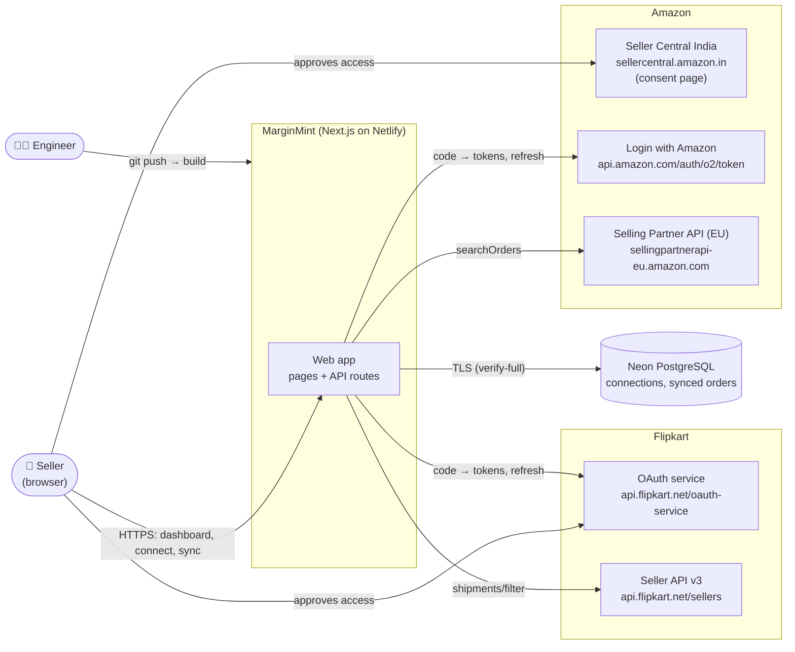
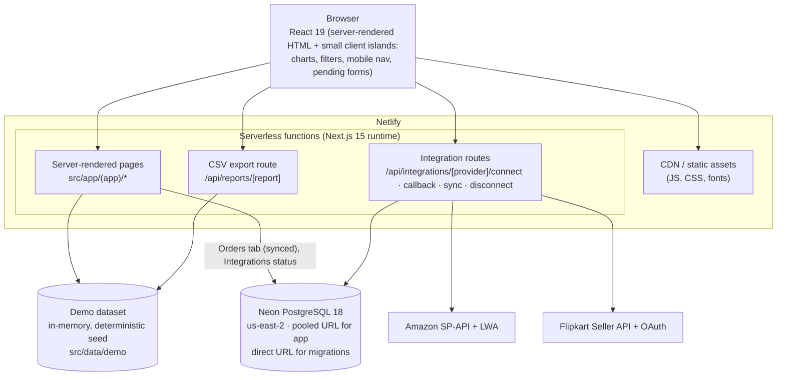
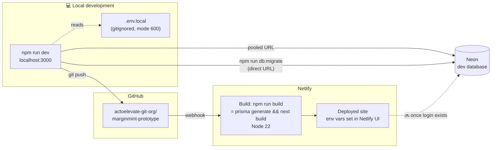

# 1. System overview

## 1.1 System context: who and what talks to MarginMint

Diagram source (Mermaid): edit here, then run <code>npm run docs:diagrams</code>

- The seller **never gives MarginMint a marketplace password**; they approve access on the marketplace's own site.
- MarginMint holds only **encrypted OAuth tokens** and **order data without buyer personal information**.
- Analytics pages (Overview, Profit Analytics, …) still run on an **in-memory demo dataset** and do not touch Neon or the marketplaces yet.

## 1.2 Containers: what runs where

Diagram source (Mermaid): edit here, then run <code>npm run docs:diagrams</code>

| Container | Technology | Notes |
|-----------|-----------|-------|
| Web app | Next.js 15 App Router, React 19, TypeScript 6 strict, Tailwind 3, Recharts 3 | Server components by default; URL holds all filter state |
| Serverless functions | Netlify's Next.js runtime | Short time limits → sync is bounded (8 pages / 8 s) and resumable |
| Demo dataset | TypeScript module, mulberry32 seed `20261011` | Built once per process; ledger cached in a `WeakMap` |
| Database | Neon PostgreSQL 18, Prisma 7.10 + `pg` driver adapter | No native engine binary; pool `max: 3` per instance |
| Amazon | LWA OAuth + SP-API Orders `2026-01-01` | India served by the EU endpoint |
| Flipkart | OAuth (authorization code) + Order Management v3 | Rolling 30-day window, six filter segments |

## 1.3 Deployment & environments

Diagram source (Mermaid): edit here, then run <code>npm run docs:diagrams</code>

| Environment | Database | Marketplace credentials | Notes |
|-------------|----------|-------------------------|-------|
| Local | Neon dev DB (migrated ✅) | Not yet issued | Demo + synced orders tab (empty until connected) |
| Netlify (current) | None configured | None | Demo-only; integration cards show "Not configured" |
| Netlify (future) | Production Neon DB | Production apps | **Only after login exists** (see [Security](08-security-architecture.md)) |

**Configuration** is read only on the server via `src/lib/env.ts` (Zod). Missing values degrade a feature to "Not configured" instead of crashing; the UI lists the missing variable **names** (never values).
