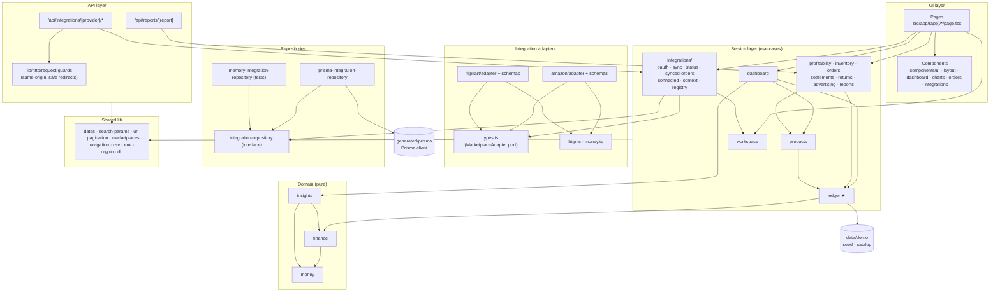
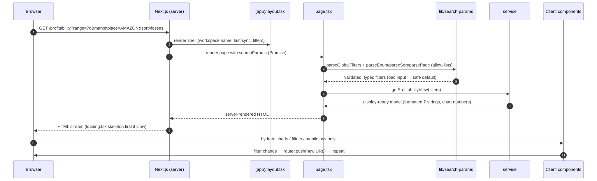
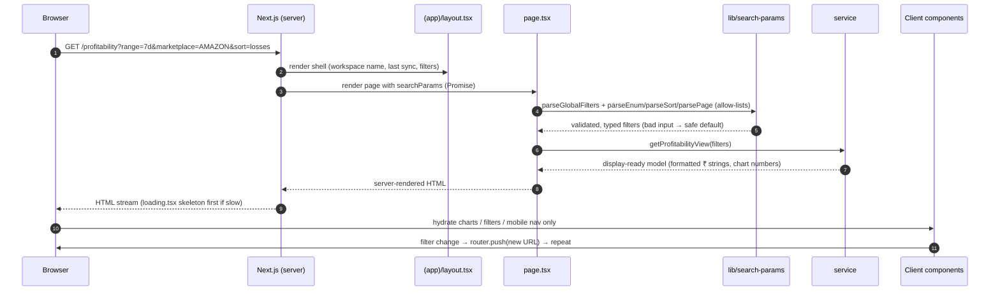

# 2. Application modules

## 2.1 Module dependency map

Arrows point from the caller to what it depends on. Dependencies only point **inward/downward**; inner modules never import outer ones.

Diagram source (Mermaid): edit here, then run <code>npm run docs:diagrams</code>

## 2.2 Layer rules (enforced in review)

| Layer | May import | Must never |
|-------|-----------|-----------|
| Pages / components | services (functions + types), `lib`, other components | Add/subtract money, query the DB, call a marketplace |
| API routes | services, `lib/http`, `lib/env` | Hold business logic |
| Services | domain, adapters (through the port), repositories (through the interface), `lib` | Render UI |
| Domain | `decimal.js`, other domain files | Do I/O, import services/repositories/UI |
| Adapters | `http.ts`, `money.ts`, Zod, `lib/env` types | Touch the database or UI |
| Repositories | Prisma client, interface types | Contain formulas |

## 2.3 Request lifecycle (any analytics page)

Diagram source (Mermaid): edit here, then run <code>npm run docs:diagrams</code>

## 2.4 Route map

| Route | Type | Rendering | Data |
|-------|------|-----------|------|
| `/` | Redirect | Static | → `/overview` |
| `/overview`, `/profitability`, `/products`, `/settlements`, `/returns`, `/advertising`, `/reports` | Page | Dynamic (search params) | Demo ledger |
| `/orders` | Page | Dynamic | Demo **or** Neon (`?source=synced`) |
| `/orders/[orderId]` | Page | Dynamic | Demo |
| `/integrations` | Page | Dynamic (`force-dynamic`) | Env + Neon |
| `/settings` | Page | Static | Config constants |
| `/api/reports/[report]` | GET | Function | Demo ledger → CSV |
| `/api/integrations/[provider]/connect` | POST | Function | Neon + redirect to marketplace |
| `/api/integrations/[provider]/callback` | GET | Function | Marketplace → token exchange → Neon |
| `/api/integrations/[provider]/sync` | POST | Function | Marketplace → Neon |
| `/api/integrations/[provider]/disconnect` | POST | Function | Neon |
