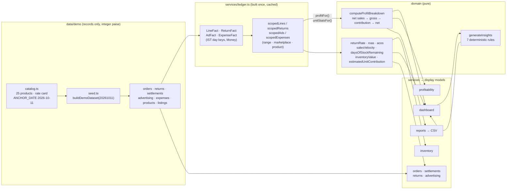
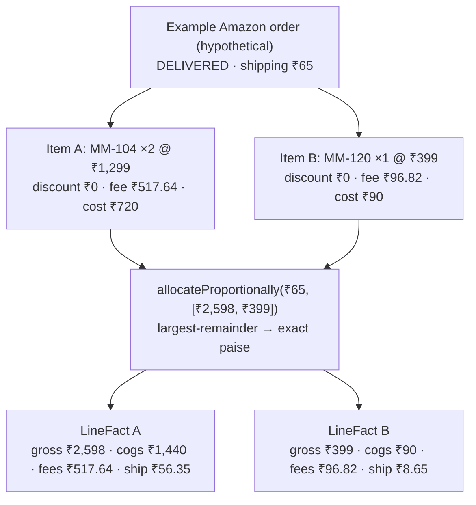
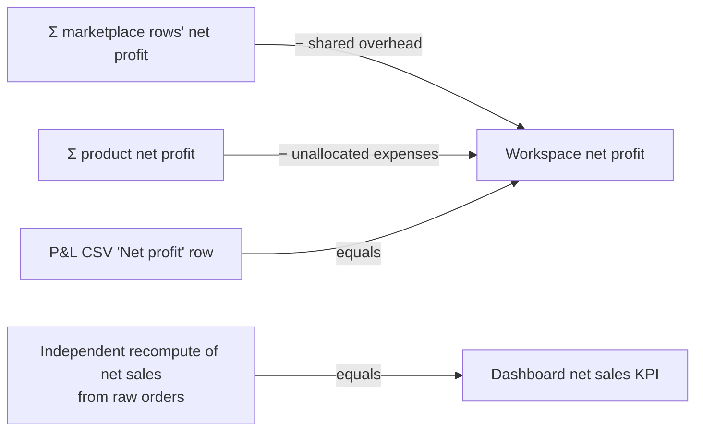
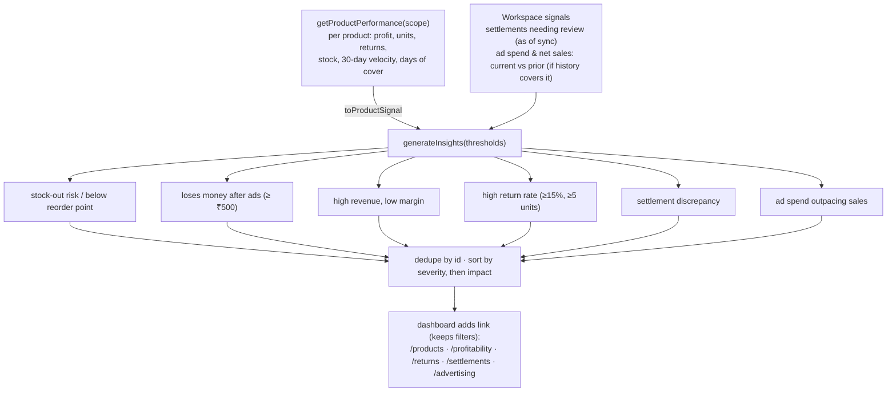

# 3. Analytics data flow

How a raw demo record becomes a number on the screen. One pipeline feeds **every** analytics page and CSV report, which is why totals always agree across pages.

## 3.1 Pipeline

Diagram source (Mermaid): edit here, then run <code>npm run docs:diagrams</code>

## 3.2 How one order line becomes facts

Diagram source (Mermaid): edit here, then run <code>npm run docs:diagrams</code>

*Hypothetical order using the real rate card (18% commission + ₹25/unit, ₹65 shipping). The numbers are what the code would produce; shipping parts always sum exactly to the order total.*

## 3.3 Profit chain

```mermaid
flowchart LR
    gross["Gross item sales"] -- "− discounts (kept lines)<br/>− cancelled line value" --> ns["Net sales"]
    ns -- "− COGS<br/>(null if any cost missing)" --> gp["Gross profit"]
    gp -- "− marketplace fees<br/>− shipping & fulfilment" --> cp["Contribution profit"]
    cp -- "− advertising<br/>− refund & return losses<br/>− other expenses" --> np["Net profit"]
    np -- "÷ net sales × 100<br/>(null if sales ≤ 0)" --> m["Net margin %"]
```

Diagram source (Mermaid): edit here, then run <code>npm run docs:diagrams</code>

## 3.4 Scope rules (what is included where)

| Fact | `range` filter | `marketplace` filter | `productId` filter |
|------|----------------|----------------------|--------------------|
| Order lines | Order date (IST) | Order's channel | Line's product |
| Returns | Return date (IST) | Return's channel | Returned product |
| Advertising | Metric date | Campaign channel | Campaign SKU |
| Expenses with a channel | Expense date | That channel | ❌ never allocated |
| Shared overhead (no channel) | Expense date | **Only "All"** | ❌ never allocated |
| Inventory | ❌ snapshot | ❌ shared stock | Product |
| Pending settlements | ❌ as of last sync | Channel | — |

## 3.5 Reconciliation guarantees (tested)

Diagram source (Mermaid): edit here, then run <code>npm run docs:diagrams</code>

All four equalities are asserted in `src/services/dashboard.test.ts`.

## 3.6 Insight generation

Diagram source (Mermaid): edit here, then run <code>npm run docs:diagrams</code>

