# 4. Amazon integration architecture

**Status:** 🧪 built and tested against Amazon's published API model; not yet run against a live seller account (no developer credentials yet).

| Fact | Value |
|------|-------|
| API | Selling Partner API (SP-API) |
| Auth | Login with Amazon (LWA) OAuth 2.0, website authorization workflow |
| Orders API | **`2026-01-01` `searchOrders`** (v0 `getOrders` is deprecated) |
| Region / host | Europe: `https://sellingpartnerapi-eu.amazon.com` (serves Amazon.in) |
| Marketplace | Amazon.in, `A21TJRUUN4KGV` |
| Consent page | `https://sellercentral.amazon.in/apps/authorize/consent` |
| Token endpoint | `POST https://api.amazon.com/auth/o2/token` |
| Code | `src/integrations/amazon/adapter.ts`, `schemas.ts` · shared: `services/integrations/*` |

## 4.1 Components and boundaries


Diagram source (Mermaid): edit here, then run <code>npm run docs:diagrams</code>

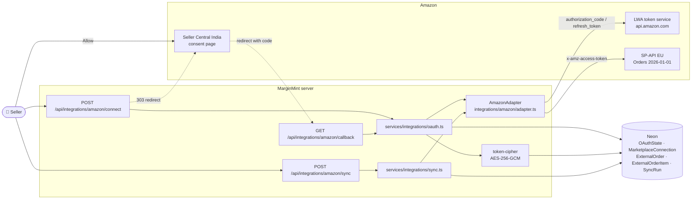

## 4.2 One-time setup (done by the MarginMint team, not by sellers)


Diagram source (Mermaid): edit here, then run <code>npm run docs:diagrams</code>

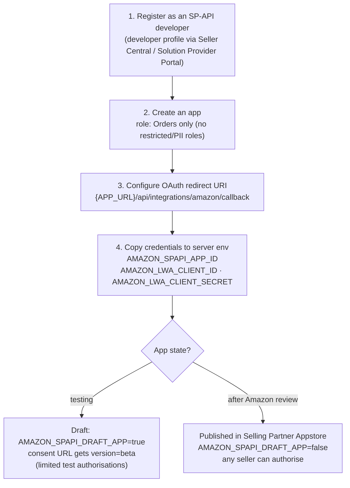

> Publishing requires Amazon's app review and compliance with Amazon's data-protection requirements. We only implement the **website** authorization flow (starts on our site). An Appstore-initiated flow would also need a "login URI" endpoint (🔜 not built).

## 4.3 Connect: authorization sequence

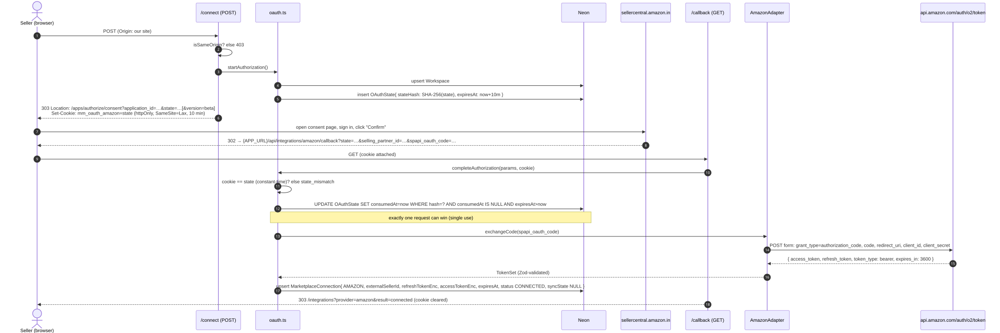

Diagram source (Mermaid): edit here, then run <code>npm run docs:diagrams</code>

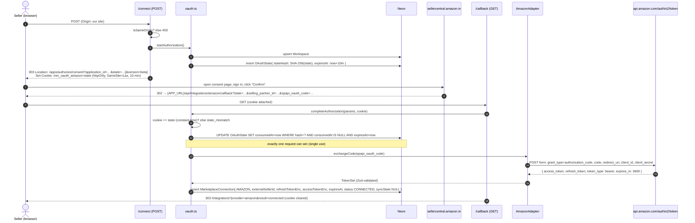

**Timing limits from Amazon:** `spapi_oauth_code` expires after **5 minutes**; the whole flow should finish within about 10 minutes. Our own state expires after 10 minutes.

## 4.4 Token lifecycle


Diagram source (Mermaid): edit here, then run <code>npm run docs:diagrams</code>

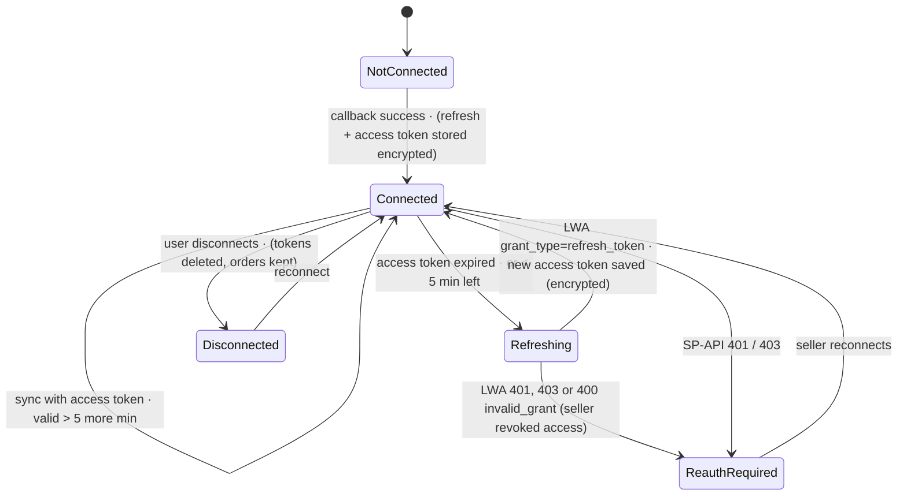

Access tokens last ~1 hour. The refresh token is long-lived and is only ever stored as AES-256-GCM ciphertext.

> **Revoked access:** OAuth token services reject a revoked refresh token with **HTTP 400 `invalid_grant`**. `integrations/http.ts` reads only the standard OAuth `error` code and classifies `invalid_grant` as `unauthorized`, so the connection switches to **Reconnect required** (roadmap I-07, tested end to end with the Amazon adapter). Confirm the exact LWA response during the first live test.

## 4.5 Order sync sequence

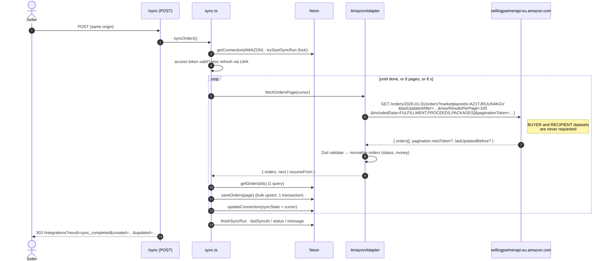

Diagram source (Mermaid): edit here, then run <code>npm run docs:diagrams</code>

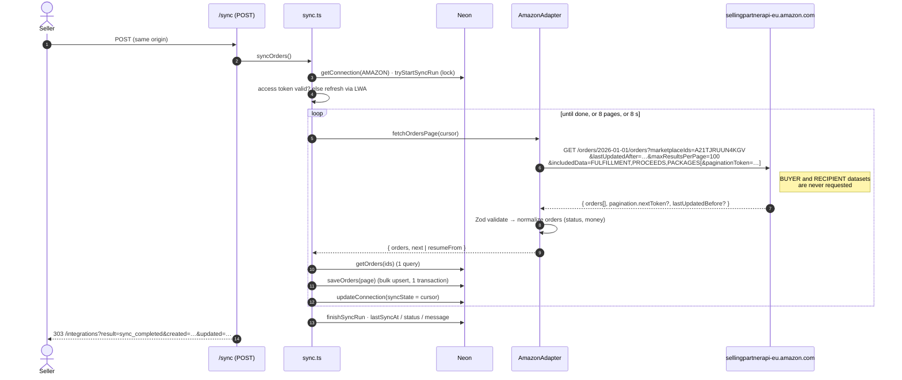

### Cursor (stored in `MarketplaceConnection.syncState`)


Diagram source (Mermaid): edit here, then run <code>npm run docs:diagrams</code>

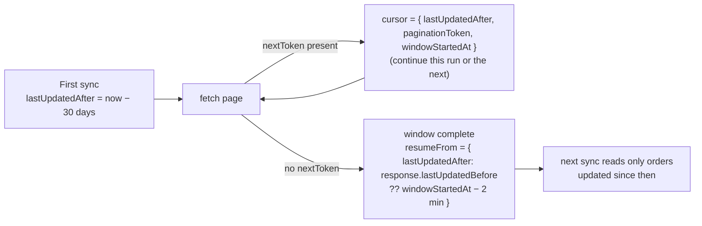

`lastUpdatedAfter` (not `createdAfter`) is used so status changes on older orders are picked up. Amazon requires exactly one of the two.

## 4.6 Data mapping


Diagram source (Mermaid): edit here, then run <code>npm run docs:diagrams</code>

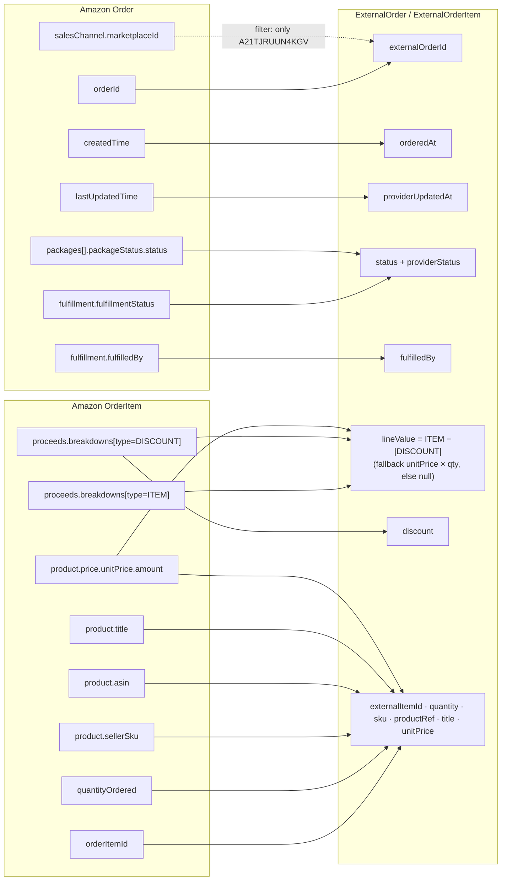

Tax breakdowns are deliberately ignored (GST is not revenue). Amounts arrive as **decimal strings** and are parsed exactly.

### Status mapping


Diagram source (Mermaid): edit here, then run <code>npm run docs:diagrams</code>

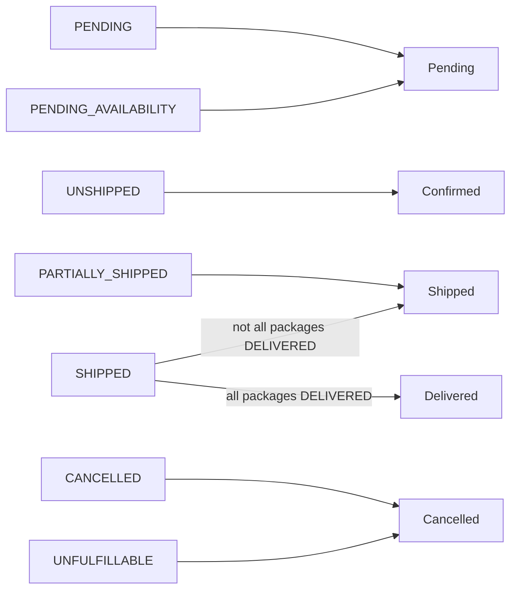

The raw Amazon status is always kept in `providerStatus` and shown under the badge.

## 4.7 Errors, retries and rate limits

| Situation | Handling | User sees |
|-----------|----------|-----------|
| 429 Too Many Requests | Retry up to 3× with backoff (honours `Retry-After`, max 10 s) | If still limited: "rate limit reached, progress saved" |
| 5xx / network | Retry up to 3×, timeout 8 s per request | "sync failed, progress up to last page saved" |
| 401 / 403 | No retry → connection `REAUTH_REQUIRED` | "Reconnect required" + Reconnect button |
| Refresh rejected with 400 `invalid_grant` | Classified as unauthorized → connection `REAUTH_REQUIRED` | "Reconnect required" + Reconnect button |
| Response fails Zod validation | `bad_response`, nothing saved for that page | "sync failed" |
| Code exchange fails / no refresh token | Nothing saved | "did not issue access tokens; check redirect URI and credentials" |

Default `searchOrders` rate: **0.0056 requests/second, burst 20**. Bursting up to 8 pages per run is within the burst budget; the resumable cursor handles the rest.

## 4.8 First live test checklist

See [Integrations §7.9](../07-marketplace-integrations.md#79-checklist-for-the-first-live-test).
