# 5. Flipkart integration architecture

**Status:** 🧪 built and tested against Flipkart's published API reference; not yet run against a live seller account or the sandbox. Five behaviours the public docs don't fully specify are isolated and marked **VERIFY IN SANDBOX** (see §5.8).

| Fact | Value |
|------|-------|
| API | Flipkart Marketplace Seller API (v3) |
| Auth | OAuth 2.0 **authorization-code** flow (third-party application) |
| Authorize | `https://api.flipkart.net/oauth-service/oauth/authorize` |
| Token | `https://api.flipkart.net/oauth-service/oauth/token` (HTTP Basic client auth) |
| Orders | `POST https://api.flipkart.net/sellers/v3/shipments/filter/` then `GET nextPageUrl` |
| Scope | `Seller_Api` |
| Sandbox | `FLIPKART_API_HOST=https://sandbox-api.flipkart.net` |
| Code | `src/integrations/flipkart/adapter.ts`, `schemas.ts` · shared: `services/integrations/*` |

## 5.1 Components and boundaries


Diagram source (Mermaid): edit here, then run <code>npm run docs:diagrams</code>

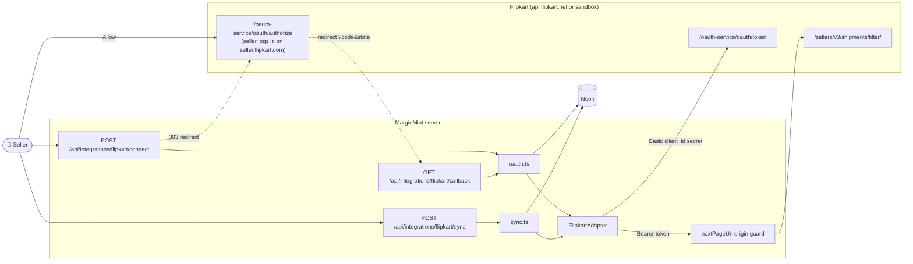

## 5.2 One-time setup (MarginMint team)


Diagram source (Mermaid): edit here, then run <code>npm run docs:diagrams</code>

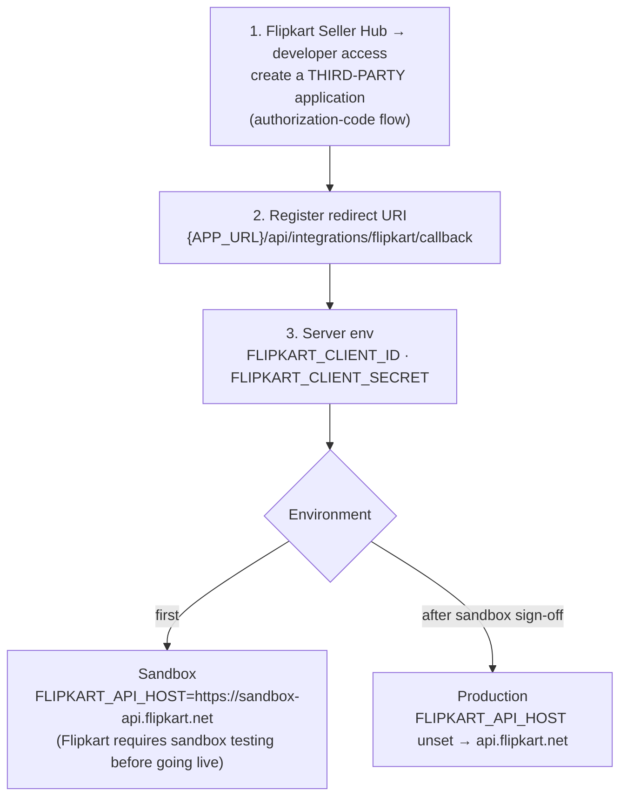

> A *self-access* application (client-credentials grant) only works for the app owner's own account and is **not** used: MarginMint connects other sellers' accounts.

## 5.3 Connect: authorization sequence

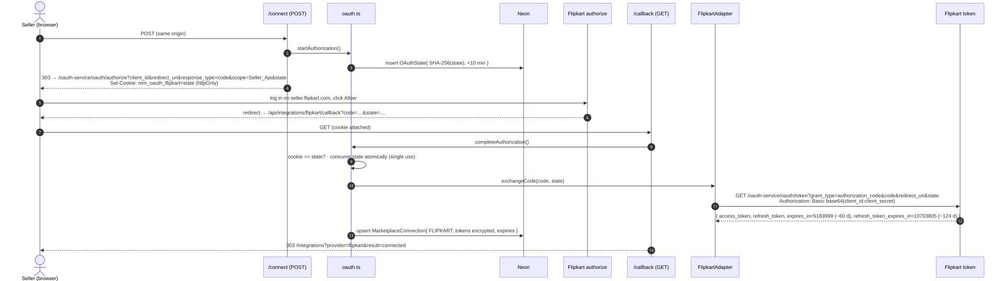

Diagram source (Mermaid): edit here, then run <code>npm run docs:diagrams</code>

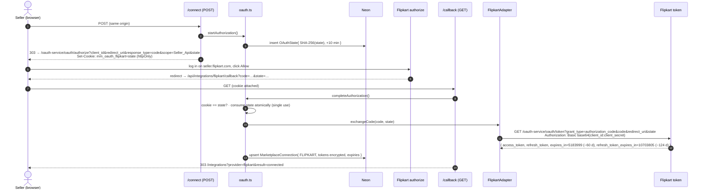

Flipkart does not return a seller ID in the token response, so the card shows "Seller ID: Not provided".

## 5.4 Why a rolling window and six segments

Flipkart's filter API has **no "modified since" filter**, and each request filters by one shipment state group. So every sync:

1. Re-reads all orders with an **order date in the last 30 days** (rolling window).
2. Walks **six filter segments** in order, paging through each.
3. **Upserts** everything. Re-reading is safe because writes are idempotent.


Diagram source (Mermaid): edit here, then run <code>npm run docs:diagrams</code>

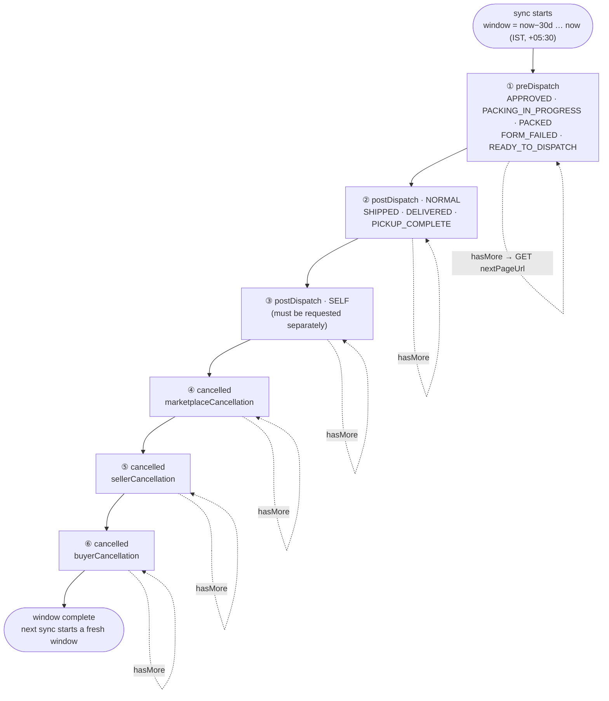

## 5.5 Order sync sequence (one page)

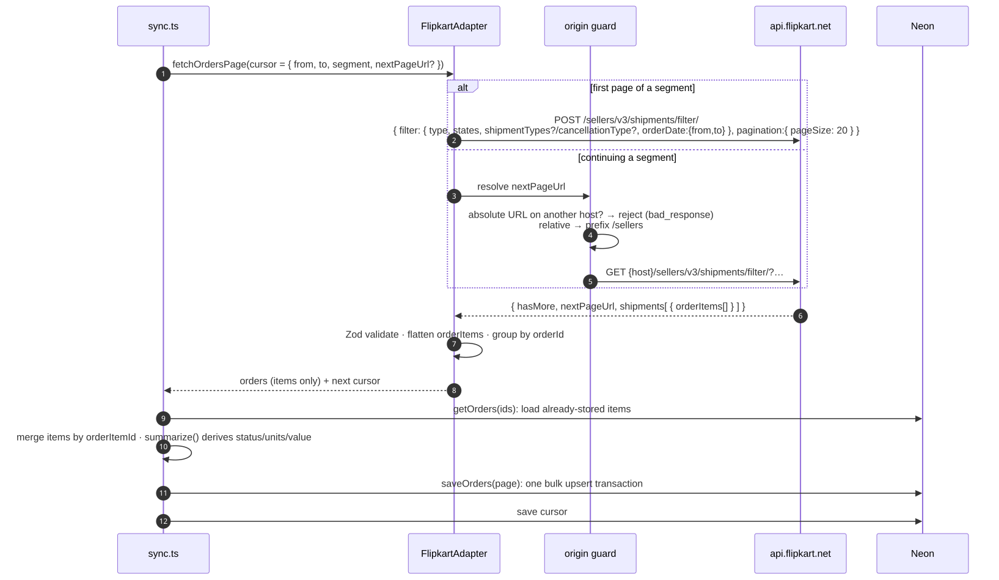

Diagram source (Mermaid): edit here, then run <code>npm run docs:diagrams</code>

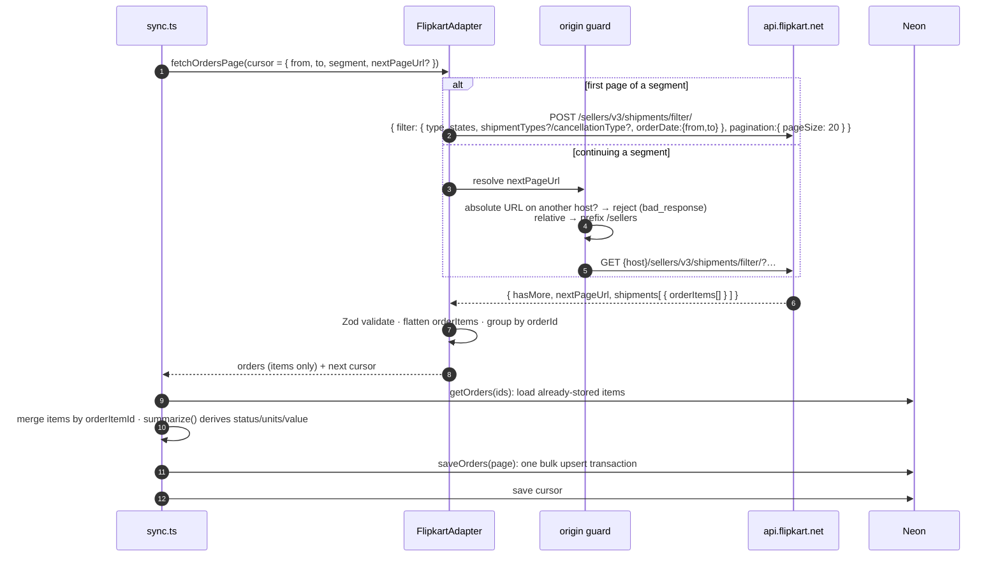

**The origin guard matters.** The `nextPageUrl` comes from the response. If a manipulated response pointed it at another host, we would send the seller's bearer token there. Absolute URLs on any other host are rejected (tested).

## 5.6 Items → orders: grouping, merging and status

Flipkart returns **order items** inside shipments. An order's items can arrive in different segments: one shipped, one cancelled. The engine merges them before deciding the order status:


Diagram source (Mermaid): edit here, then run <code>npm run docs:diagrams</code>

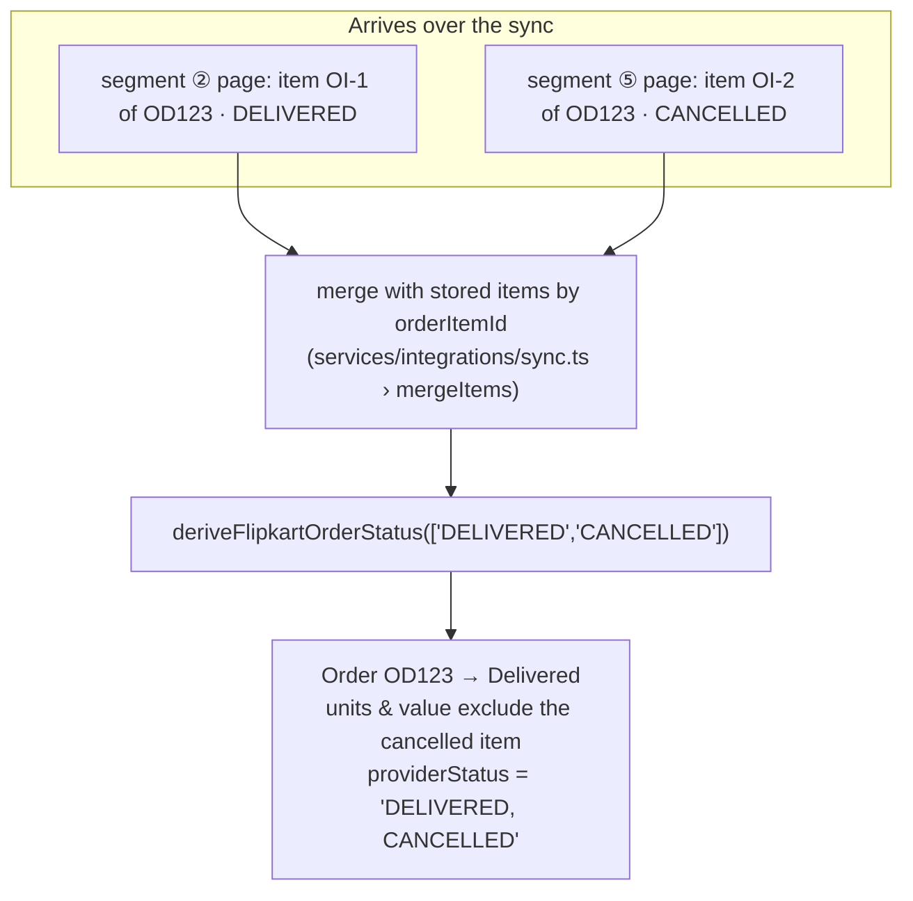

### Item status → MarginMint status


Diagram source (Mermaid): edit here, then run <code>npm run docs:diagrams</code>

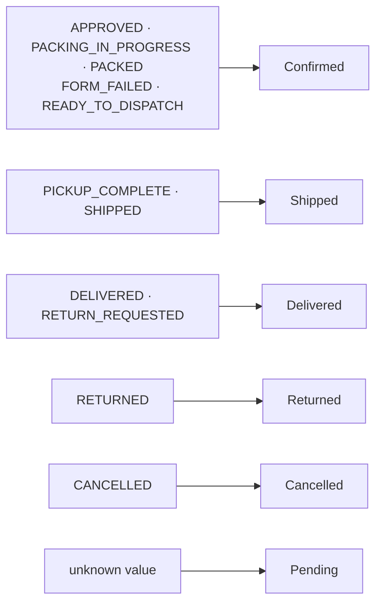

### Order status from all its items


Diagram source (Mermaid): edit here, then run <code>npm run docs:diagrams</code>

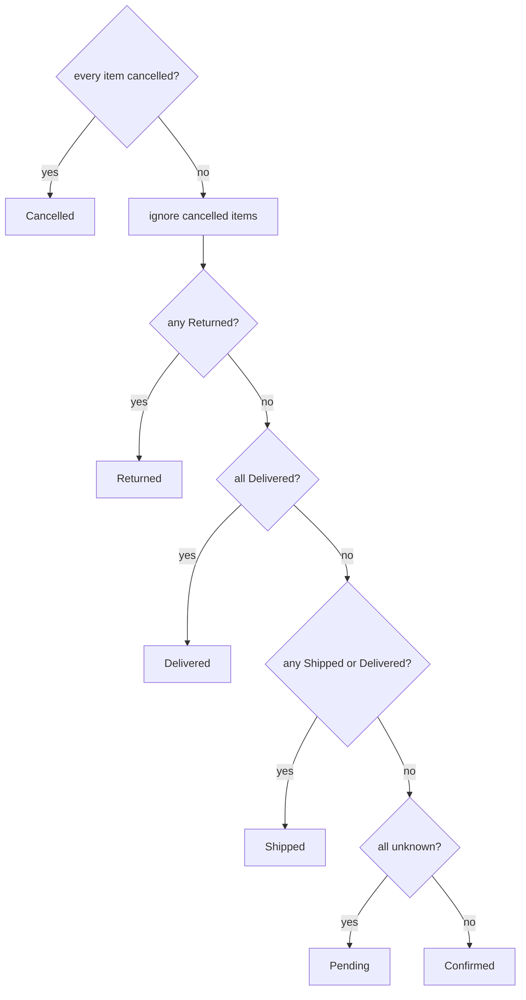

## 5.7 Data mapping

| Flipkart field | MarginMint column | Notes |
|----------------|-------------------|-------|
| `orderItems[].orderId` | `ExternalOrder.externalOrderId` | Items grouped by this |
| `orderItems[].orderDate` | `ExternalOrder.orderedAt` | No timezone in the value → parsed as IST (`+05:30`) |
| `orderItems[].orderItemId` | `ExternalOrderItem.externalItemId` | Merge key across pages/segments |
| `orderItems[].status` | `ExternalOrderItem.providerStatus` → order `status` | See 5.6 |
| `orderItems[].sku` | `sku` | |
| `orderItems[].fsn` | `productRef` | Flipkart Serial Number |
| `orderItems[].quantity` | `quantity` | |
| `priceComponents.sellingPrice` | `lineValue`; `unitPrice = lineValue ÷ qty` | JSON **number** → string → `Decimal`, rounded half-up to paise. *Assumed to cover the whole line.* |
| `priceComponents.flipkartDiscount` | not stored as a discount | Funded by Flipkart, not the seller → seller discount = unknown (`null`) |
| `priceComponents.shippingCharge`, `totalPrice` | not used | Customer-paid shipping is not item value |
| *(not provided)* | `title` = null, `fulfilledBy` = null | |

## 5.8 ⚠️ Assumptions to verify in the sandbox

| # | Assumption | Where | If wrong |
|---|-----------|-------|----------|
| 1 | Token endpoint accepts **GET** with query params (docs only show `curl` without `-X`) | `FlipkartAdapter.token()` | Switch to POST with form body |
| 2 | Refresh uses `grant_type=refresh_token&refresh_token=…` | `refreshAccessToken()` | Adjust parameters |
| 3 | `nextPageUrl` format (absolute / host-relative / relative to `/sellers`) | `resolvePageUrl()` | All three handled; confirm which |
| 4 | `sellingPrice` is for the **whole line**, not per unit | `mapItem()` | Multiply by quantity |
| 5 | `orderDate` filter works for post-dispatch and cancelled segments | `FLIPKART_SEGMENTS` | Use `dispatchAfterDate` / `cancellationDate` instead |

A refresh rejected with **400 `invalid_grant`** switches the connection to "Reconnect required" (shared handling in `integrations/http.ts`, roadmap I-07).

## 5.9 Errors and limits

| Situation | Handling |
|-----------|----------|
| 429 / 5xx / network | Up to 3 retries with backoff (honours `Retry-After`), 8 s timeout per request |
| 401 / 403 | Connection → `REAUTH_REQUIRED` |
| Invalid response shape or foreign `nextPageUrl` | `bad_response`, page not saved |
| Page size | 20 (Flipkart maximum); up to 5,000 records per filter |
| Rate limits | Not published in the reference; covered by retry + resumable cursor |
| Returns (`RETURN_REQUESTED`, `RETURNED`) | Not in filter states; needs Flipkart's returns API (🔜) |
