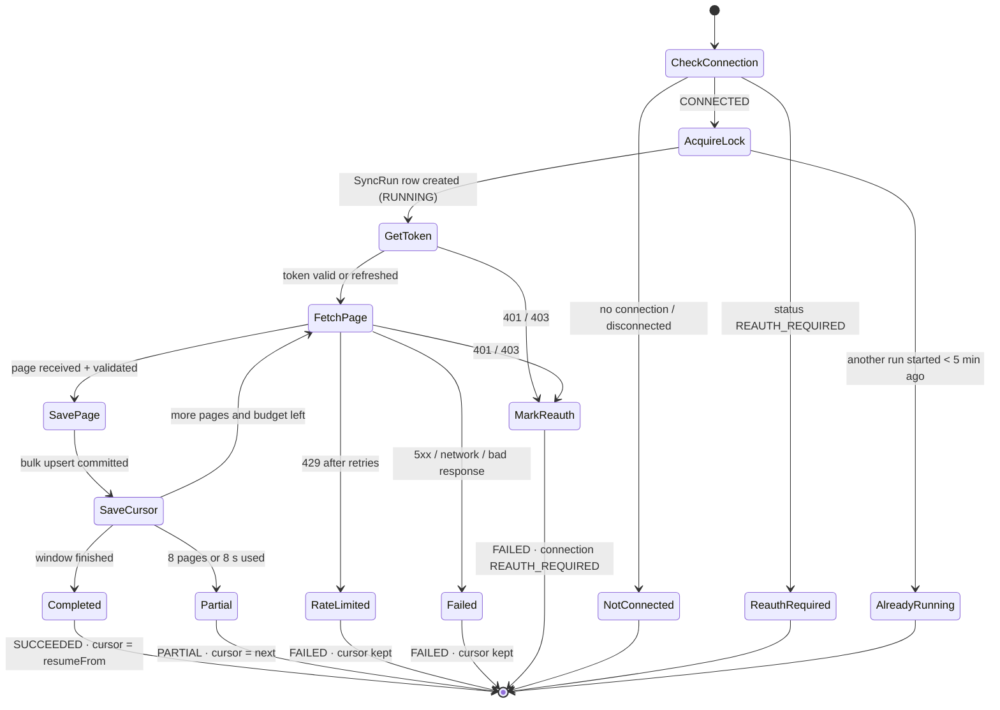
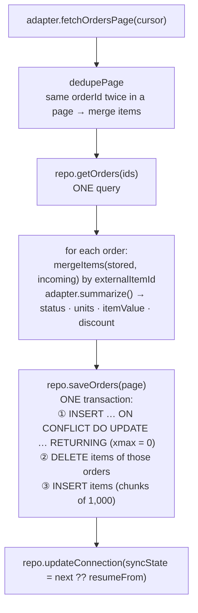

# 6. Sync engine

`src/services/integrations/sync.ts › syncOrders()` is **provider-agnostic**. Amazon and Flipkart differ only inside their adapters (`fetchOrdersPage`, `parseCursor`, `summarize`).

## 6.1 Run lifecycle

Diagram source (Mermaid): edit here, then run <code>npm run docs:diagrams</code>

Every terminal state writes a `SyncRun` row (status, counts, safe message) and updates the connection's `lastSyncAt / lastSyncStatus / lastSyncMessage`.

## 6.2 Inside one page

Diagram source (Mermaid): edit here, then run <code>npm run docs:diagrams</code>

**Why batched:** with ~230 ms per database round trip, saving orders one by one cost ~2.5 min per 100-order page; batched, it is ~1.8 s (measured on Neon).

**Why the cursor is saved after every page:** a crash, timeout or rate limit never loses completed work; the next run resumes from the last saved page.

## 6.3 Guarantees

| Guarantee | Mechanism |
|-----------|-----------|
| **No duplicates** | Unique `(workspaceId, provider, externalOrderId)`; items replaced per order; unique `(orderId, externalItemId)` |
| **No lost items** across pages/segments | Merge with stored items before saving |
| **Bounded runtime** (serverless) | Max 8 pages or 8 s per run, then `PARTIAL` |
| **Resumable** | Provider-specific cursor in `MarketplaceConnection.syncState` (Zod-validated on read; invalid → fresh start) |
| **One run at a time** | `tryStartSyncRun`: a `RUNNING` run less than 5 min old blocks new runs; stale runs (crashed functions) stop blocking after 5 min |
| **Fresh tokens** | Reuse the access token if > 5 min left, else refresh and save encrypted |
| **Safe messages** | Fixed text per outcome; provider responses never stored or shown |

## 6.4 Cursor shapes

| Provider | Cursor | Next run after completion |
|----------|--------|---------------------------|
| Amazon | `{ lastUpdatedAfter, paginationToken?, windowStartedAt? }` | `lastUpdatedAfter = response.lastUpdatedBefore ?? windowStartedAt − 2 min` (incremental) |
| Flipkart | `{ from, to, segment (0–5), nextPageUrl? }` | `null` → fresh rolling 30-day window (full re-read, idempotent) |

## 6.5 Triggers

| Trigger | Status |
|---------|--------|
| "Sync orders now" (Integrations card) | ✅ |
| "Sync Amazon / Sync Flipkart" (Orders tab, synced view) | ✅ |
| Scheduled background sync | 🔜 Netlify Scheduled Function calling `syncOrders` for each connection; the engine is already lock-protected and resumable |
