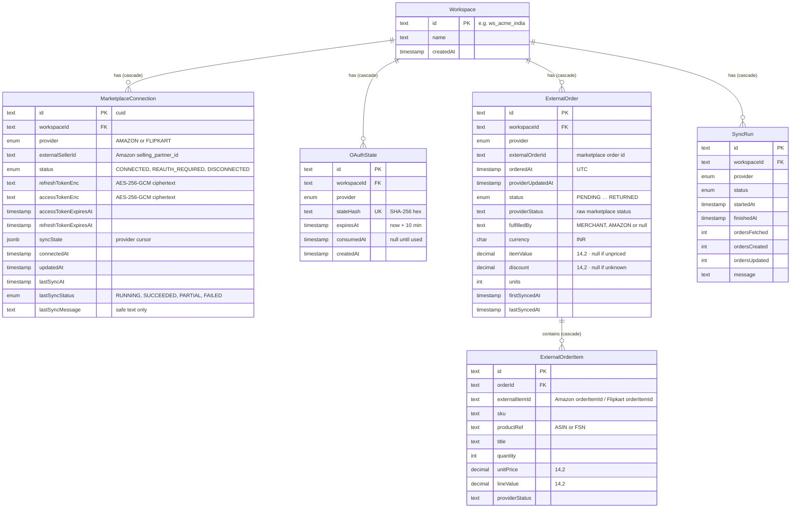

# 7. Data model

Source of truth: `prisma/schema.prisma` · migration `prisma/migrations/20261011000000_marketplace_integrations/migration.sql`.

## 7.1 Entity-relationship diagram (as built)

Diagram source (Mermaid): edit here, then run <code>npm run docs:diagrams</code>

## 7.2 Keys and indexes

| Table | Unique | Indexes | Why |
|-------|--------|---------|-----|
| `MarketplaceConnection` | `(workspaceId, provider)` | — | One account per marketplace per workspace |
| `OAuthState` | `stateHash` | `expiresAt` | Fast lookup on callback; cheap cleanup of old states |
| `ExternalOrder` | `(workspaceId, provider, externalOrderId)` | `(workspaceId, orderedAt)`, `(workspaceId, provider, status)` | Idempotent upsert; Orders tab date range and status tabs |
| `ExternalOrderItem` | `(orderId, externalItemId)` | — | One row per marketplace line |
| `SyncRun` | — | `(workspaceId, provider, startedAt)` | Lock check + history |

## 7.3 Data deliberately NOT stored

- Buyer name, email, phone, address (Amazon `BUYER`/`RECIPIENT` never requested)
- Plaintext tokens (ciphertext only) or raw OAuth `state` (hash only)
- Raw provider payloads (only normalized fields)

## 7.4 Where demo data lives

The analytics demo dataset is **not** in the database. It is generated in memory from `src/data/demo/seed.ts`. Its shapes (`DemoOrder`, `DemoProduct`, `DemoReturn`, `DemoSettlementTxn`, `DemoAdMetric`, `DemoExpense`) are in `src/data/demo/types.ts`. See [Target architecture](09-target-architecture.md) for the plan to persist analytics data.
