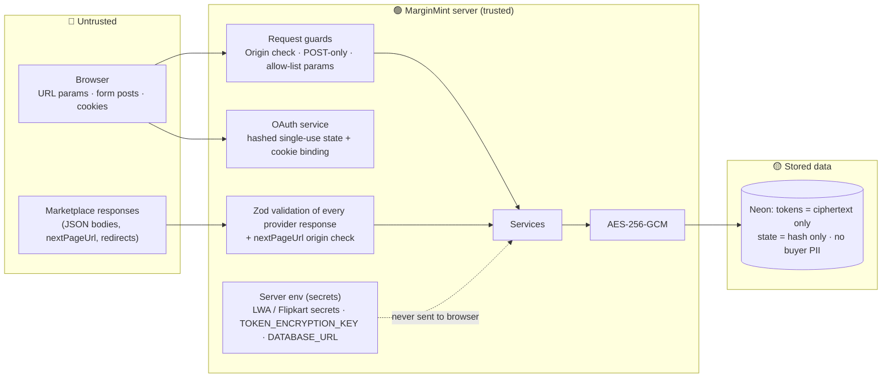
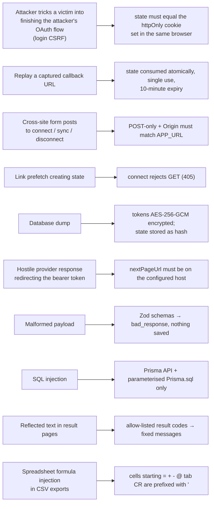
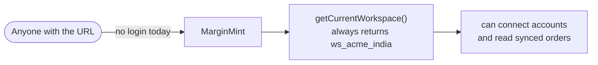

# 8. Security architecture

## 8.1 Trust boundaries

Diagram source (Mermaid): edit here, then run <code>npm run docs:diagrams</code>

## 8.2 Where each secret lives

| Secret | Location | Reaches the browser? | Stored in DB? |
|--------|----------|----------------------|---------------|
| `AMAZON_LWA_CLIENT_SECRET`, `FLIPKART_CLIENT_SECRET` | Server env | ❌ | ❌ |
| `TOKEN_ENCRYPTION_KEY` | Server env | ❌ | ❌ |
| `DATABASE_URL` (password) | Server env | ❌ | — |
| Seller refresh / access tokens | Server memory during a request | ❌ | ✅ ciphertext only |
| OAuth `state` | httpOnly cookie (browser) + hash in DB | Only as an opaque httpOnly cookie | ✅ SHA-256 hash only |

## 8.3 Attack → defence map

Diagram source (Mermaid): edit here, then run <code>npm run docs:diagrams</code>

## 8.4 The open gap

Diagram source (Mermaid): edit here, then run <code>npm run docs:diagrams</code>

Every query is already scoped by `workspaceId`, and the workspace always comes from the server. Adding login means changing `getCurrentWorkspace()` to return the **signed-in member's** workspace (see [Target architecture](09-target-architecture.md)). Until then, real credentials must stay off public deployments. Full details: [Security](../09-security.md).
