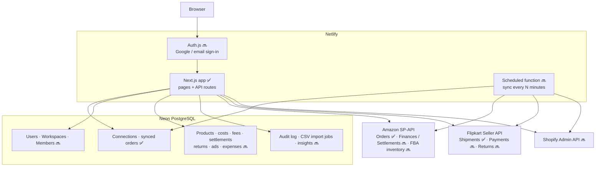
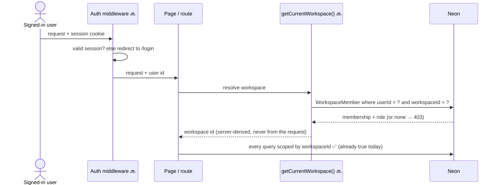
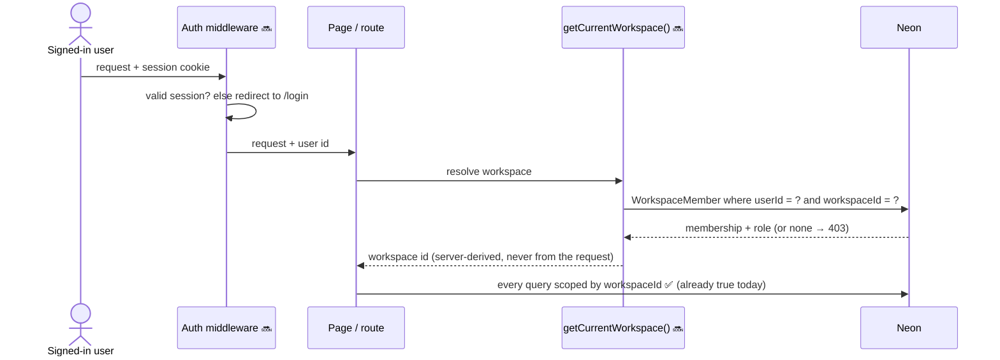
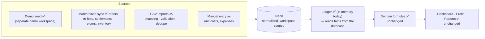

# 9. Target architecture

Where the system is heading, based on the product spec ([`MarginMint.md`](../../MarginMint.md)) and the [roadmap](../12-known-gaps-and-roadmap.md). Nothing on this page is built unless marked ✅.

## 9.1 Target containers

Diagram source (Mermaid): edit here, then run <code>npm run docs:diagrams</code>

## 9.2 Target request path (with login)

Diagram source (Mermaid): edit here, then run <code>npm run docs:diagrams</code>

## 9.3 Target analytics data flow

Diagram source (Mermaid): edit here, then run <code>npm run docs:diagrams</code>

**Design intent:** the domain formulas and pages stay unchanged; only the ledger's data source moves from the in-memory seed to the database. This is why the ledger exists.

## 9.4 Migration path

| Step | Change | Unblocks |
|------|--------|----------|
| 1 | Auth.js + `User`/`WorkspaceMember`; `getCurrentWorkspace()` from session | Real deployment with real data |
| 2 | First live Amazon (Draft) + Flipkart sandbox run; fix differences | Trustworthy sync |
| 3 | Scheduled sync (Netlify Scheduled Functions) | Always-fresh orders |
| 4 | Persist products & unit costs; map synced SKUs to products | Real COGS → real profit |
| 5 | Import fees and settlements (Amazon Finances, Flipkart payments) | Real net profit + reconciliation |
| 6 | Ledger reads from the database | Dashboard on real data |
| 7 | CSV import, settlement matching workflow, audit log | Operational workflows from the spec |
| 8 | Shopify adapter | Third marketplace |
